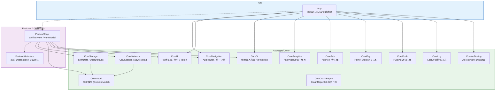

# iOS 现代项目架构 AI 规则

**架构风格：** 基于现代 iOS 离线优先、三级模块化最佳实践（SwiftUI + Swift 6 并发 + SPM 本地模块化）

**角色：** iOS 架构守护者，严格遵循现代 iOS 工程范式

**项目性质：** 多模块骨架/模板，无业务代码。所有 feature 模块需在真实项目中按需添加。

---

## 总体架构



- 采用 `App` / `Features:*` / `Core:*` 三级模块化布局。
- **Feature 模块必须拆分为 `FeatureInterface` 和 `FeatureImpl` 两个子模块/Target**，外部仅依赖 Interface 模块。
- **Interface 模块**只暴露导航目标（`NavDestination`）、服务协议（Protocol）和共享数据类，不包含 UI 或业务实现。
- **依赖方向严格单向：** `App → Features:Impl → Core:*`。
- **Feature 模块按需添加**，骨架项目不包含任何业务 Feature 模块。
- `bundleIdentifier` 统一使用占位符 `xxx.yyy.zzz`，禁止在逻辑中硬编码。

---

## 架构决策记录 (ADR)

本项目使用 ADR（Architecture Decision Record）记录架构决策。

- **存放位置：** `docs/adr/` 目录
- **格式：** MADR（Markdown Architectural Decision Records）
- **模板：** `docs/adr/0000-adr-template.md`
- **状态定义：**
  - `Proposed` — 提议中，待评审
  - `Accepted` — 已接受，开始实施
  - `Deprecated` — 已废弃
  - `Superseded` — 被其他 ADR 替代
- **何时新增 ADR：**
  - 引入新的技术选型或第三方库
  - 修改已生效的架构规则
  - 任何涉及跨模块影响的架构决策
- **编写规范：**
  - 使用中文编写，技术名词保留英文
  - 编号按时间顺序递增
  - 状态必须明确标注

---

## 模块清单

### App 模块
- Application 入口，`@main struct App`。
- 启动时初始化 `AppDependencyGraph` 装配依赖。
- 持有顶层 `RootView` 与 `NavigationStack`。
- **无业务代码**。

### Feature 模块
#### `Feature*Interface`
- 对外暴露类型安全导航目标（`Hashable & Codable NavDestination`）。
- 外部调用的 Service 协议定义与领域入参。
- **无 UI、无具体业务实现**。

#### `Feature*Impl`
- SwiftUI Screen 视图 + ViewModel。
- 注册 ViewModel 与 Repository 到 `CoreDI` 容器。

### Core 模块
#### `CoreModel`
- 纯 Swift 领域模型，遵循 `Sendable`、`Codable`、`Hashable`、`Identifiable`。
- **零框架依赖，无业务逻辑**。

#### `CoreNetwork`
- 基于 `URLSession` + Swift 现代并发（`async`/`await`）封装。
- 提供 `Endpoint` 协议、`APIClient`、JSON 序列化配置与统一错误类型 `NetworkError`。
- **目录结构规范：**
  - `Model/`：存放网络传输 DTO（Data Transfer Object）。
  - `Client/`：网络请求执行引擎。

#### `CoreStorage`
- 本地持久化封装：支持 `UserDefaults`（轻量键值）、`Keychain`（安全令牌）、`SwiftData` / 文件存储。
- 提供本地数据源（Local DataSource）协议与实现。
- **只暴露 async 函数或 Combine / AsyncSequence 数据流**。

#### `CoreNavigation`
- 基于 iOS 16+ `NavigationPath` 的类型安全导航中心。
- 提供 `AppRouter` 封装，支持 `push`、`pop`、`popToRoot` 与深度链接（Deep Link）解析。

#### `CoreUI`
- 设计系统颜色 Token、排版字体、间距与圆角标准。
- 通用基础视图（`LoadingView`、`ErrorView`、`PrimaryButton`、`AdaptiveStack` 等）。

#### `CoreDI`
- 原生轻量级依赖注入中心（`DependencyContainer` + `@Injected` Property Wrapper）。
- 线程安全（Swift 并发隔离），支持按协议解析与测试环境 Fake 替换。

#### `CoreAnalytics`
- 透出 `AnalyticsKit` 门面（统一事件名、参数键与提供商协议）。
- 业务直接调用 `Analytics.logEvent(name, params)`。

#### `CoreAds`
- 透出 `AdsKit` 门面（广告初始化、插屏、激励视频、横幅广告代理调度）。
- 业务直接调用 `AdsManager.shared`。

#### `CorePay`
- 基于原生 `StoreKit 2` 封装的 `PayKit` 门面。
- 提供订阅状态查询、交易监听、购买流程唤起与凭证恢复。

#### `CorePush`
- 透出 `PushKit` 门面（APNs 远程推送注册、通知权限请求、本地通知调度）。

#### `CoreLog`
- 基于 Apple 原生 `os.Logger` 封装的 `LogKit` 门面。
- 支持 DEBUG 彩色输出、日志分类（Subsystem / Category）与安全脱敏。

#### `CoreAbTesting`
- 透出 `AbTestingKit` 门面（远程配置获取与本地默认值 Fallback）。

#### `CoreCrashReport`
- 透出 `CrashReportKit` 门面（捕获未处理异常与关键路径日志记录）。

#### `CoreTesting`
- 单元测试与 UI 测试辅助库，提供通用 Fake 实现与异步测试断言扩展。

---

## 依赖注入 (CoreDI)

### 强制规则
- **全面禁止引入三方重量级侵入式 DI 框架**，使用轻量原生 `CoreDI` 容器。
- App 启动时调用 `AppDependencyGraph.registerAll()` 完成服务装配。

### 注册与解析规范
```swift
// 1. 服务协议与实现注册
DependencyContainer.shared.register(UserRepositoryProtocol.self) {
    UserRepositoryImpl(network: DependencyContainer.shared.resolve(), storage: DependencyContainer.shared.resolve())
}

// 2. ViewModel 或业务类中通过属性包装器使用
final class UserViewModel: ObservableObject {
    @Injected private var userRepository: UserRepositoryProtocol
}
```

---

## UI 与状态层规范

### SwiftUI
- UI **完全使用 SwiftUI**。
- **禁止在业务页面中引入 UIViewController / UIView**（除极个别特殊能力封装为 `UIViewRepresentable` 外）。

### 状态管理
- 推荐使用 Swift 现代状态感知方案（iOS 17+ `@Observable` 或 `ObservableObject`）。
- 每个 Screen 对应一个 ViewModel。
- ViewModel **只暴露单一完整的 UiState 状态流**：
  ```swift
  struct UserUiState: Sendable {
      var isLoading: Boolean = false
      var user: User? = nil
      var errorMessage: String? = nil
  }
  ```
- **单次事件**（如弹窗 Toast、路由跳转）必须在消费后立即置空，**严禁在 UiState 中永久残留**。

### Composable / View 规范
- 可复用子视图 **必须无状态**（Stateless），仅接收数据和 Action 回调闭包。
- **禁止在 View 中直接调用网络请求或存储操作**，所有异步副作用必须委托给 ViewModel。

---

## 路由与导航

- 跨模块导航**必须基于 `CoreNavigation` 的 `AppRouter` 与各 Feature Interface 暴露的 `NavDestination`**。
- **禁止硬编码页面类型直接跨模块跳转**。

---

## 数据层 (Data Layer)

### Repository 实现
- 实现 Repository，组合 Remote + Local 数据源。
- **采用离线优先（Offline-First）策略**：先返回本地可用缓存，再拉取远端同步。

### 数据转换
- DTO（网络响应）/ Entity（本地存储）**必须通过 Mapper 转换为领域模型（Domain Model）**。
- **禁止在模块间直接传递 DTO 或数据库持久化实体**。
- **命名规范：**
  - 网络数据传输对象必须以 `DTO` 结尾（如：`UserDTO`）。
  - 本地持久化实体必须以 `Entity` 结尾（如：`UserEntity`）。
  - 纯领域模型无后缀（如：`User`）。

### 错误处理
- 必须使用 Swift 原生 `Result<Success, Failure>` 或 `throws` 强类型 `AppError`。
- **禁止吞掉错误返回空数据**。

---

## 测试规范

### Mock 策略
- **禁止使用动态运行时 Mock 工具**。
- **必须使用手写协议 Fake 实现**（如 `FakeUserRepository: UserRepositoryProtocol`）。

### 异步测试
- 使用 Swift 6 `async/await` 现代异步测试方式，配合 Swift Testing 或 XCTest。

---

## 脚手架与自动化

### 占位符规范
- 生成脚手架项目时，所有 `bundleIdentifier`、团队标识、命名空间统一使用占位符 `xxx.yyy.zzz`。

### 初始化脚本
- 项目根目录包含 `init_project.sh` 脚本，用于一键替换占位符为真实值：
  ```bash
  ./init_project.sh
  ```
- 脚本执行后项目应可直接通过 `swift build` 或 Xcode 编译通过。

---

## 禁止项

1.  **禁止在 Feature 模块间直接依赖 Impl 模块**（必须依赖 Interface）。
2.  **禁止在 View 视图层直接导入和调用网络/存储层**。
3.  **禁止使用全局单例持有可变业务状态**（单例仅允许作为无状态服务，状态必须收敛在 ViewModel/UDF）。
4.  **禁止强制解包（`!`）**，除 `init(coder:)` 模板代码外一律禁止。
5.  **禁止吞没底层异常**，必须将其统一映射为可读的领域错误。

---

## 代码注释规范

- **所有公开类、结构体、协议、关键函数必须添加中文注释**。
- 注释说明职责与核心逻辑，不赘述代码语法明示的内容。
- **示例：**
  ```swift
  /// 用户资料仓储协议，负责协调本地缓存与远端服务器同步。
  public protocol UserRepositoryProtocol: Sendable {
      /// 获取用户详情。优先返回本地缓存，并异步拉取网络更新。
      /// - Parameter userId: 用户唯一标识
      /// - Returns: 领域模型实体
      func getUser(by userId: String) async throws -> User
  }
  ```

---

**最后更新：** 2026-11-02  
**适用项目：** iOS 现代架构模板（SwiftUI + SPM + Swift 6 并发）
