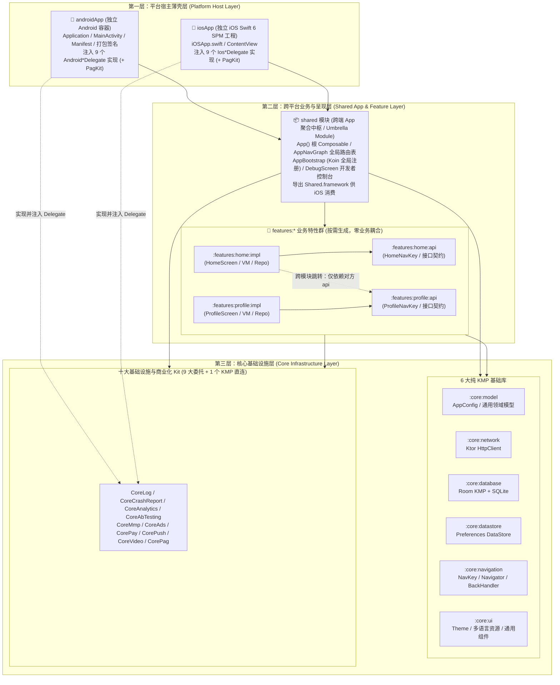
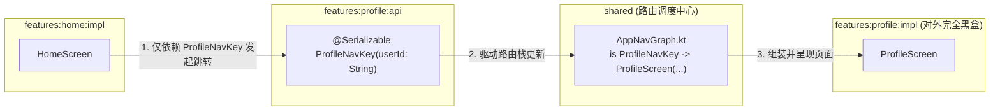
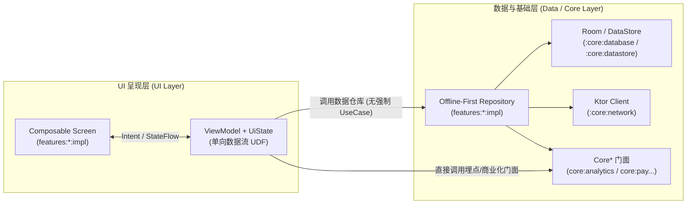
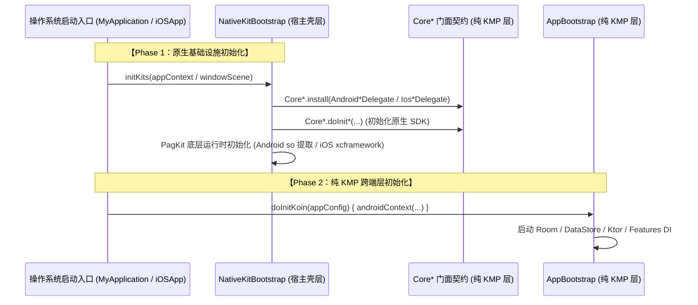
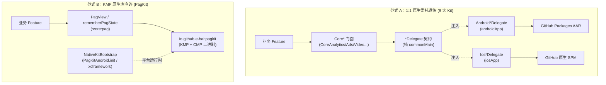

# Kotlin Multiplatform (KMP) 跨平台架构基线

> **基线定位**：对齐 JetBrains 2026 最新官方规范 **[A New Default Project Structure for Kotlin Multiplatform](https://blog.jetbrains.com/kotlin/2026/05/new-kmp-default-structure/)** 与 **Android Gradle Plugin (AGP) 9.0** 的工业级移动端跨平台架构脚手架。  
> 采用 **Compose Multiplatform (CMP) + Koin + Room KMP + Ktor + 十大基础设施与商业化 Kit 双范式接入**，实现双端 UI 与业务逻辑极致共享、底层原生能力零损耗穿透。

---

## 目录索引
1. [⚡ 30 秒极速上手 (Quick Start)](#1-30-秒极速上手-quick-start)
2. [🏛️ 架构全景图与每一层的作用](#2-架构全景图与每一层的作用)
3. [🔗 层间调用关系与架构铁律](#3-层间调用关系与架构铁律)
4. [🧭 新代码应该放在哪里？（开发速查表）](#4-新代码应该放在哪里开发速查表)
5. [🔌 十大 Kit 跨平台接入架构（双范式）](#5-十大-kit-跨平台接入架构双范式)
6. [🧠 KMP 双端 API 调用边界与互操作原理](#6-kmp-双端-api-调用边界与互操作原理)

---

## 1. 30 秒极速上手 (Quick Start)

### 1.1 一键极简项目立项初始化 (`init_project.sh`)
本脚手架支持一键全自动重命名命名空间、应用 ID、插件前缀、App 名称与 iOS 工程配置，并**直接将默认的 `:features:home` 转换为新项目的首页模块**（零示例代码清理负担）：

```bash
# 方式 A：交互式向导（自动推导默认值，按回车即可完成）：
./init_project.sh

# 方式 B：单行命令行参数极速立项（支持独立指定正式与测试应用 ID；加 `--yes` 自动采用其余默认值）：
./init_project.sh \
  --package com.example.news \
  --app-id com.example.news \
  --test-app-id com.example.news.dev \
  --name "NewsApp" \
  --features "news,favorites,profile" \
  --yes
```
> **提示**：通过 `--features` 参数可同时批量生成并自动挂载多个初始业务特性模块；`--app-id` 与 `--test-app-id` 自动写入双端工程配置。

### 1.2 业务模块与 Kit 热插拔管理 (`create_feature.sh` / `remove_feature.sh` / `manage_kit.sh`)
当需要为项目添加新的业务特性时，运行：
```bash
./create_feature.sh profile              # 标准 UI + ViewModel 模块
./create_feature.sh profile --with-data  # 额外生成 Offline-First Repository 数据层样板
```
该脚本采用标准 `api` + `impl` 规范生成模块，并**全自动完成以下挂载（无需手动修改任何配置文件）**：
1. `settings.gradle.kts`：注册 `:features:profile:api` 与 `:features:profile:impl`；
2. `shared/build.gradle.kts`：自动追加依赖项；
3. `AppBootstrap.kt`：自动导入并注册 `profileModule` Koin 依赖注入；
4. `AppNavGraph.kt`：自动导入 `ProfileNavKey` 与 `ProfileScreen` 并挂载路由分支；
5. 自动执行 Spotless 代码规范格式化。

需要卸载不需要的业务特性或 Kit 模块时，直接执行一键逆向裁剪脚本：
```bash
./remove_feature.sh profile          # 一键移除业务特性目录与全部路由/DI/Gradle 锚点
./manage_kit.sh list                 # 检视十大 Kit 启用状态
./manage_kit.sh remove video         # 一键双端全链路裁剪指定 Kit（含 Delegate 与 DebugSection）
```

### 1.3 双端应用 ID 与测试/正式签名隔离规范

为支持测试环境（Firebase / 广告 / 归因测试工程）与正式上架环境彻底隔离，工程预置了双端隔离机制：

- **Android 端 (`androidApp/build.gradle.kts`)**：
  - **测试环境唯一入口 (`config/dev.properties`)**：开箱即跑，包含测试包名（`${package}.dev`）、桌面名称（`xxx (Dev)`）、API 域名及 Google 官方测试广告 ID，默认锁定 `devDebug` 构建变体；若未配置签名自动回退到系统 debug 签名；
  - **正式环境唯一入口 (`config/prod.properties`)**：日常开发无需理会，发版前从 `config/prod.properties.example` 复制创建并填写真实生产凭证；
- **iOS 端 (`iosApp/Config/`)**：
  - **测试环境唯一入口 (`iosApp/Config/Dev.xcconfig`)**：Debug 绑定测试 Bundle ID、桌面名称 `xxx (Dev)`、测试 AdMob ID 与 `Apple Development` 证书；
  - **正式环境唯一入口 (`iosApp/Config/Prod.xcconfig`)**：Release 绑定正式 Bundle ID、正式桌面名称与 `Apple Distribution` 证书。

> 💡 **标准作业程序 (SOP)**：有关 Android `keytool` 双证书生成、SHA-1 指纹提取、iOS Apple 开发者后台 CSR / `.p12` / 描述文件配置的完整操作步骤，请参阅 [docs/sop/0001-app-signing-and-certificates.md](docs/sop/0001-app-signing-and-certificates.md)。

### 1.4 常用构建、单测与检查命令

| 任务 | 执行命令 | 说明 |
| :--- | :--- | :--- |
| **编译运行 Android (测试包)** | `./gradlew :androidApp:assembleDevDebug` | 生成测试 ID + 测试签名的 Android Debug APK |
| **打包 Android (正式发布包)** | `./gradlew :androidApp:assembleProdRelease` | 生成正式 ID + 正式签名的 Release APK/AAB |
| **生成 iOS Xcode 工程** | `cd iosApp && xcodegen generate --spec project.yml` | 由 `project.yml` 本地生成 `iosApp.xcodeproj`（已纳入 `.gitignore`，避免团队 `pbxproj` 冲突） |
| **运行 iOS 宿主集成测试** | `cd iosApp && xcodebuild -project iosApp.xcodeproj -scheme iosApp-Dev -destination 'platform=iOS Simulator,name=iPhone 17 Pro' test` | 在 iOS Simulator 中真机链路测试 `Shared.framework` + 9 大 `Ios*Delegate`（CI 自动选定可用模拟器 UDID） |
| **编译链接 iOS 框架** | `./gradlew :shared:linkDebugFrameworkIosSimulatorArm64` | 验证 `Shared.framework` 导出与链接 |
| **构建无 Debug 面板 Prod 包** | `./gradlew :androidApp:assembleProdRelease -PenableDebugPanel=false` | 构建期物理裁剪 `:features:debug` 与 `like.pag`（iOS `Release` 构建由 `project.yml` 自动传入） |
| **运行全模块单元测试** | `./gradlew allTests` | 运行全跨平台 `commonTest`、Android 单元测试与 iOS Simulator 测试 |
| **格式化代码风格** | `./gradlew spotlessApply` | 依据官方 ktlint 规范自动格式化全工程代码 |
| **代码规范静态检查** | `./gradlew spotlessCheck` | CI 门禁检查代码格式 |

---

## 2. 架构全景图与每一层的作用

### 2.1 三级模块化分层全景图 (Three-Tier Modularization)



### 2.2 每一层的核心职责与边界对照表

| 层次与模块 | 物理形态 | 核心职责与包含内容 | 严禁事项 (Don'ts) | 与传统 Android `:app` 对应关系 |
| :--- | :--- | :--- | :--- | :--- |
| **`androidApp` / `iosApp`**<br/>（平台宿主薄壳层） | 独立 App 工程<br/>(`com.android.application` / Swift 6 Xcode) | 1. 声明操作系统入口（`Application`/`MainActivity`/`iOSApp.swift`）；<br/>2. 系统权限、签名、Flavor/Scheme 变体打包；<br/>3. 在 `delegates/` / `Delegates/` 下按文件隔离实现 9 大 `*Delegate` 并由 `NativeKitBootstrap` 装配。 | ❌ 严禁在此编写具体业务 UI 页面；<br/>❌ 严禁直接被任何 KMP 模块反向依赖。 | 继承原 `:app` **10%** 的纯系统宿主容器与打包职责。 |
| **`shared`**<br/>（跨端 App 组装层） | 纯 KMP 库<br/>(`myproject.kmp.library` + CMP) | 1. 承载 CMP 根视图 `App.kt`；<br/>2. 全局路由分发表 `AppNavGraph.kt`；<br/>3. 全局 Koin 依赖注入聚合中心 `AppBootstrap.kt`；<br/>4. 打包并导出 `Shared.framework` 供 iOS 消费。 | ❌ **严禁在此直接编写具体业务页面或业务数据仓库**（业务与调试面板均下沉至 `features:*`）。 | 继承原 `:app` **90%** 的跨端路由分发、DI 组装与根 UI 挂载职责。 |
| **`features:*`**<br/>（跨端业务特性层） | 纯 KMP 库群<br/>(`api` + `impl` 成对出现) | 1. **`:api` 模块**：仅包含 `@Serializable` 的 `NavKey` 路由键及对外暴露的接口契约（供其他业务模块跳转使用）；<br/>2. **`:impl` 模块**：承载具体 CMP `Screen`、`ViewModel`、`UiState`、离线优先 `Repository` 与 `Koin Module`。 | ❌ 外部业务模块严禁直接依赖对方的 `:impl` 模块；<br/>❌ 严禁跨模块传递未沉淀的模型实体。 | 对应原生多模块架构中的 `:feature:*` 业务特性模块。 |
| **`core:*`**<br/>（核心基础设施层） | 纯 KMP 库群<br/>（单向底层依赖） | 1. **6 大基础库**：通用模型（`model`）、网络（`network`）、数据库（`database`）、键值存储（`datastore`）、导航状态机（`navigation`）、基础 UI 与多语言（`ui`）；<br/>2. **十大 Kit 模块**：9 大纯 `commonMain` 透传门面 + 1 个 KMP 直连库（`core:pag`）。 | ❌ 严禁反向依赖任何上层业务模块或 `shared` 模块；<br/>❌ 9 大透传模块严禁包含 `androidMain` 与 `iosMain`。 | 对应原生多模块架构中的 `:core:*` 基础设施库。 |

### 2.3 物理工程目录树

```
Architecture/
├── androidApp/                                  # [第一层：Android 宿主薄壳]
│   ├── src/main/AndroidManifest.xml
│   └── src/main/kotlin/xxx/yyy/zzz/android/
│       ├── MyApplication.kt                     # 冷启动两段式初始化入口
│       ├── MainActivity.kt                      # 挂载 CMP App() 根视图
│       └── bridge/
│           ├── NativeKitBootstrap.kt            # 十大 Kit 统一引导装配器
│           └── delegates/Android*Delegate.kt    # 9 个独立拆分的原生委托实现
├── iosApp/                                      # [第一层：iOS 宿主薄壳]
│   ├── project.yml                              # XcodeGen 单一真源（引入 e-hai/*-iOS 与 Vendor/LibPag SPM）
│   ├── DebugResources/                          # 仅 Debug 构建打入的调试资源 (如 like.pag)
│   ├── Vendor/LibPag/Package.swift              # libpag.xcframework 官方 binaryTarget SPM 包装
│   └── Sources/
│       ├── iOSApp.swift                         # SwiftUI App 入口
│       └── Bridge/
│           ├── NativeKitBootstrap.swift         # 十大 Kit 统一引导装配器
│           └── Delegates/Ios*Delegate.swift     # 9 个独立拆分的原生委托实现
├── shared/                                      # [第二层：跨端 App 组装中枢 / 纯胶水伞模块]
│   ├── build.gradle.kts                         # 聚合 features 与 core，导出 Shared.framework
│   └── src/commonMain/kotlin/xxx/yyy/zzz/shared/
│       ├── App.kt                               # Compose Multiplatform 根入口
│       ├── di/AppBootstrap.kt                   # 全局 Koin 依赖注入组装中心
│       └── navigation/AppNavGraph.kt            # 全局跨平台路由表分发器（含 defaultStartKey）
├── features/                                    # [第二层：跨平台独立业务特性群]
│   ├── home/                                    # 默认首页特性模块 (api + impl)
│   └── debug/                                   # 可插拔开发者调试台模块 (api: DebugSection + impl)
│       ├── api/                                 # DebugNavKey + DebugSection 扩展契约
│       └── impl/sections/                       # 各个 Kit 独立的插件化调试区块 (按 Kit 单文件)
├── core/                                        # [第三层：核心基础设施与门面契约]
│   ├── model/                                   # AppConfig 运行时环境 / 通用数据实体
│   ├── network/                                 # Ktor HTTP Client 封装
│   ├── database/                                # Room KMP + BundledSQLiteDriver 数据库
│   ├── datastore/                               # DataStore Preferences 跨端持久化
│   ├── navigation/                              # NavKey / Navigator / BackHandler 跨端导航状态机
│   ├── ui/                                      # 主题 / composeResources 多语言 / 通用控件
│   ├── log/                                     # CoreLog 门面 + LogTags (直连 e-hai/LogKit)
│   ├── crashreport/                             # CoreCrashReport 门面 + CrashReportKeys
│   ├── analytics/                               # CoreAnalytics 门面 + Events / Params
│   ├── abtesting/                               # CoreAbTesting 门面 + Keys
│   ├── mmp/                                     # CoreMmp 门面 + Events / Params
│   ├── ads/                                     # CoreAds 门面 + AdsKeys
│   ├── pay/                                     # CorePay 门面 + PayProducts
│   ├── push/                                    # CorePush 门面 + PushChannels
│   ├── video/                                   # CoreVideo 门面 + 播放控制器 (直连 e-hai/VideoKit)
│   └── pag/                                     # CorePag 门面 + PagView CMP 动效 (直连 e-hai/PagKit)
├── build-logic/                                 # Gradle Convention 约定插件
├── docs/                                        # 项目工程文档库
│   ├── ARCHITECTURE.md                          # 架构设计与技术全景指南
│   ├── adr/                                     # 架构决策记录 (ADR 0000 ~ 0009 - 记录 Why)
│   └── sop/                                     # 标准作业程序 (SOP 0000 ~ 0001 - 记录 How)
├── init_project.sh                              # 一键极简项目初始化脚本
├── create_feature.sh                            # 一键业务特性创建与自动挂载脚本
├── remove_feature.sh                            # 一键业务特性安全移除脚本
├── manage_kit.sh                                # 一键 Kit 状态检视与裁剪脚本
├── scripts/ensure_libpag_xcframework.sh         # Kotlin/Native libpag 缓存保障脚本
└── settings.gradle.kts                          # 全局模块声明
```

---

## 3. 层间调用关系与架构铁律

### 3.1 跨 Feature 模块间协作与解耦（Feature A → Feature B）
当 `Home` 模块需要跳转到 `Profile` 模块时，严格遵循 **「面向契约接口通信」** 铁律：



1. `:features:home:impl` 的 `build.gradle.kts` 中只需声明：
   ```kotlin
   implementation(project(":features:profile:api")) // 严禁依赖 :features:profile:impl
   ```
2. 在 `HomeScreen` 中发起跳转：
   ```kotlin
   navigator.navigate(ProfileNavKey(userId = "123"))
   ```
3. 彻底杜绝跨业务模块的循环依赖与私有实现泄露。

---

### 3.2 业务代码与数据流分层（精简两层架构：UI Layer → Data Layer）
本工程严格遵循 Google 官方 **Modern App Architecture (Guide to App Architecture)** 规范，采用精简的**两层逻辑架构**，拒绝产生大量仅有一行代码透传的无意义 `UseCase`：



- **离线优先 (Offline-First)**：Repository 优先读取本地 Room 缓存，网络更新后写回本地数据库并驱动 UI 响应式刷新；
- **按需局部提取 UseCase**：仅在遇到跨多个 Repository 的极其复杂的业务编排或多 ViewModel 复用算法时，才在对应 `impl` 内部按需提取局部 UseCase。

---

### 3.3 双段式冷启动流向 (Two-Phase Initialization)
为了严格隔离原生 SDK 与纯跨端 KMP 容器，两端宿主在启动时均遵循严格的**双段式初始化时序**：



---

### 3.4 四大依赖红线 (Architecture Rules)

1. **红线一：严禁业务代码上浮到 `shared`**
   - `shared` 只能做胶水组装（`App.kt`、`AppNavGraph.kt`、`AppBootstrap.kt`），禁止在此编写具体的业务页面和业务数据仓库。
2. **红线二：业务模块间严禁直接依赖 `:impl`**
   - 业务特性模块之间只能单向依赖对方的 `:api`，禁止访问对方的内部实现细节。
3. **红线三：KMP 跨平台层严禁引用原生 SDK**
   - `shared`、`features:*` 和 `core:*` 中严禁 `import` 任何原生 AAR 或 SPM API，所有商业化能力必须 100% 通过 `core:*` 静态门面（`Core*`）调用。
4. **红线四：底层 `core:*` 模块严禁反向依赖业务**
   - `core:*` 单向被上层依赖，严禁反向 `implementation(project(":features:*"))` 或 `project(":shared")`。

---

## 4. 🧭 新代码应该放在哪里？（开发速查表）

| 我想要实现什么？（日常开发场景） | 目标模块与物理目录 | 操作步骤与指南 |
| :--- | :--- | :--- |
| **1. 新增一个完整的业务特性页面**<br/>（如新建个人中心 `profile`） | `features/profile/api`<br/>`features/profile/impl` | 直接运行 `./create_feature.sh profile`（如需附带 Offline-First Repository 样板可加 `--with-data`），在生成的 `ProfileScreen.kt` 与 `ProfileViewModel.kt` 中编写业务逻辑即可，脚本会自动挂载路由与 DI。 |
| **2. 在现有业务模块内添加子页面或弹窗**<br/>（如商品模块的规格选择弹窗） | `features/<name>/impl/src/commonMain` | 在该特性的 `impl` 目录下新增 Composable 控件与对应状态模型，并在现有 Screen 中调用。 |
| **3. 从 A 业务页面跳转到 B 业务页面**<br/>（如首页点击头像跳转个人中心） | `features/A/impl/build.gradle.kts` | 在 A 的 `impl` 中添加 `implementation(project(":features:B:api"))`，在 Screen 中调用 `navigator.navigate(BNavKey(...))`。 |
| **4. 编写业务网络请求与本地持久化逻辑**<br/>（如文章列表离线缓存） | `features/<name>/impl` + `core:database` | 1. 在 `core:database` 定义 Entity/DAO；<br/>2. 在业务 `impl` 中编写 `XxxRepository`，组装 Ktor 与 Room 实现离线优先，并注册到 `<Name>Module.kt`。 |
| **5. 新增全局通用的跨模块领域模型**<br/>（如全局用户信息 `UserProfile`） | `core/model/src/commonMain` | 在 `core:model` 中声明 `@Serializable data class UserProfile(...)`，全工程所有模块默认直接可见。 |
| **6. 新增全局通用 UI 组件或多语言文案**<br/>（如统一按钮、全局错误页） | `core/ui/src/commonMain` | 1. 通用组件放入 `core:ui/src/commonMain/kotlin/.../components/`；<br/>2. 多语言文本写入 `core/ui/src/commonMain/composeResources/values/strings.xml`（中英文对齐）。 |
| **7. 新增埋点事件、AB 实验 Key 或内购商品 ID** | `core:analytics` / `core:abtesting` / `core:pay` | 在对应门面模块的常量文件中声明（如 `AnalyticsEvents.kt`、`AbTestingKeys.kt`、`PayProducts.kt`），业务层通过 `Core*` 门面调用。 |
| **8. 修改第三方原生 SDK 初始化参数或接入新渠道** | `androidApp` & `iosApp` | 仅在 `androidApp/.../NativeKitBootstrap.kt` 与 `iosApp/.../NativeKitBootstrap.swift` 的私有 `*Delegate` 中调整原生 SDK 参数，跨端代码零修改。 |
| **9. 编写单元测试** | `features/*/impl/src/commonTest` 或 `core/*/src/commonTest` | 遵循「Fake over Mock」，通过 `Core*.install(Fake*Delegate())` 或直接实例化 `FakeRepository`，配合 `runTest` 与 `Turbine` 秒级运行。 |

---

## 5. 十大 Kit 跨平台接入架构（双范式）

针对移动端 10 大自研基础设施与商业化 SDK，工程全面下线 JitPack，统一迁移至 **GitHub Packages**，并按依赖底层形态分为两大标准化范式：



### 5.1 范式 A：1:1 原生委托透传（9 大 Kit）
涵盖 `log`, `crashreport`, `analytics`, `abtesting`, `mmp`, `ads`, `pay`, `push`, `video`：
- **统一 `Core*` 门面命名**：门面统一使用 `Core*` 前缀（`CoreLog`、`CoreCrashReport`、`CoreAnalytics`、`CoreAbTesting`、`CoreMmp`、`CoreAds`、`CorePay`、`CorePush`、`CoreVideo`），Android 端彻底告别 `as` 别名，iOS 端彻底告别 `Shared.` 前缀消歧；
- **原生 SDK 物理隔离**：全工程唯一调用原生 AAR / SPM API 的地方严格限制在双端宿主私有的 `*Delegate` 内部；
- **双端代码 100% 对称**：初始化方法统一使用 `doInit*` 命名（如 `doInitAllLog()`），规避 Kotlin/Native 导出 Objective-C 时的隐式改名；
- **单测与 Compose Preview 零崩溃**：门面内部预置 `Default*Delegate` 兜底实现，单测与 IDE 预览永远不会因“原生 SDK 未初始化”抛出异常。

### 5.2 范式 B：KMP 原生库直连门面包装（PagKit）
涵盖 `pag`：
- **`:core:pag` 统一封装**：直接在 `commonMain` 中依赖 `io.github.e-hai:pagkit`，向业务层暴露 `CorePag` 门面及 `PagView` 声明式组件；
- **宿主零 Delegate 负担**：宿主无需编写任何视图桥接代码，仅在 `NativeKitBootstrap` 中处理底层 `.so` / 动态库加载。

---

## 6. KMP 双端 API 调用边界与互操作原理

1. **`androidMain` 调用 Android 官方 API（Kotlin / Java）？**
   - **100% 全部支持，零障碍**。因为 `androidMain` 本质就是编译成 JVM 字节码，无论是 `android.*`（Java）还是 `androidx.*` / Jetpack（Kotlin），直接 `import` 即可。
2. **`androidMain` 调用自定义的 Kotlin / Java API 需要特殊处理吗？**
   - **不需要任何特殊处理**。无论是同模块下的 `.kt`/`.java` 文件，还是通过 Gradle `implementation` 引入的自定义/第三方 `.jar`、`.aar`，字节码天然互通（唯一限制仅在于 Gradle 模块不能反向依赖顶层 `androidApp` 壳工程）。
3. **`iosMain` 能调用所有的 iOS 官方 API（包括 Swift 或 Objective-C）吗？**
   - **不能调用全部！** `kotlinc-native` 内置的 `platform.*` 仅通过 `cinterop` 绑定了系统 **C 和 Objective-C 头文件（`.h`）**（如 `Foundation`、`UIKit`）。对于 Apple 近年来推出的**纯 Swift 官方框架**（如 `SwiftUI`、`StoreKit 2`、`CryptoKit`、`SwiftData`、`TipKit`），由于没有 Obj-C 头文件，`iosMain` **物理上完全不可见、无法直接调用**。
4. **`iosMain` 调用自定义的 Swift 或 Objective-C API 需要特殊处理吗？**
   - **需要特殊处理，且难度差异巨大**：
     - **自定义 Objective-C / C**：需要编写 `.def` 文件并在 Gradle 中配置 `cinterop`（或通过 CocoaPods 插件），让编译器把 `.h` 头文件翻译成 Kotlin 存根后才能调用。
     - **自定义 Swift（或纯 Swift SPM 库）**：`iosMain` **完全无法直接调用**。若强行用 `expect/actual`，必须把 Swift 代码加上 `@objc` 并阉割掉所有纯 Swift 特性（Struct/泛型/枚举关联值），先用 Xcode 打成带 `*-Swift.h` 的 XCFramework 再配 Gradle `cinterop`；**正因这条路极度繁琐脆弱，凡涉及纯 Swift（官方或自定义），本质上都倒逼架构放弃 `expect/actual`，改用 `interface` + 运行期依赖注入（在 Swift 宿主中实现接口并注入回 KMP）**。
5. **为什么 9 大原生 Kit 采用宿主 Delegate 桥接，而 PagKit 能在 `core:pag` 中直接依赖？**
   - **纯 Swift SPM 阻断 vs KMP 预编译产物**：9 大原生 Kit 在 iOS 端是 **纯 Swift 6 SPM 库（`e-hai/*-iOS`，含 `StoreKit 2`、Swift `struct`/`enum`、`async/await`）**，Kotlin/Native 的 `iosMain` 物理上无法直接依赖纯 Swift SPM；而 `PagKit` 本身已编译为包含 iOS `.klib` 的标准 KMP 依赖，支持在 `commonMain` 直接消费；
   - **宿主生命周期与上下文隔离**：`AdsKit`（广告展示）、`PayKit`（应用内购）、`VideoKit` 等 SDK 强依赖前台 `Activity` / `UIViewController` 实例，放在最外层 App 宿主桥接最自然，避免平台专属 UI 上下文污染底层 `core:*`；
   - **重型依赖隔离与单测/Preview 零崩溃**：将 Firebase、AppsFlyer、AppLovin MAX、Play Billing 等庞大原生 SDK 隔离在顶层 App 壳工程，使得 `core:*` 与 `features:*` 保持 100% 纯 `commonMain` 轻量契约（自带 `Default*Delegate` 兜底与 `Fake*Delegate`），增量编译速度极快，单测与 IDE 预览永远不会崩溃。
