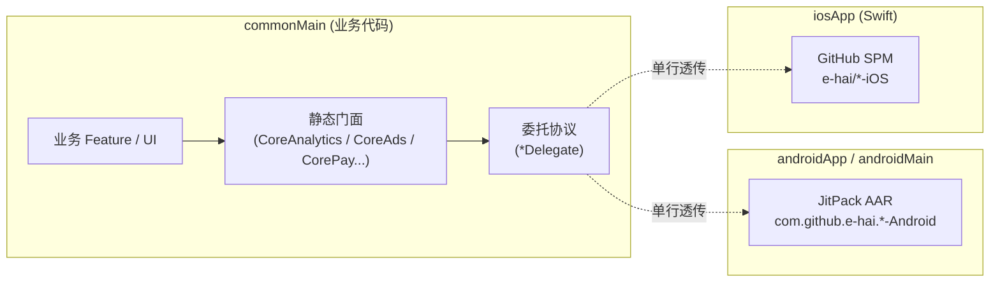

# Kotlin Multiplatform (KMP) 跨平台架构基线

> **基线定位**：对齐 JetBrains 2026 最新官方规范 **[A New Default Project Structure for Kotlin Multiplatform](https://blog.jetbrains.com/kotlin/2026/05/new-kmp-default-structure/)** 与 **Android Gradle Plugin (AGP) 9.0** 的工业级跨端架构骨架。

---

## 架构拓扑与目录布局

本工程采用「平台宿主独立外置 + 共享内核模块化」的 2026 最新设计：

```
Architecture/
├── androidApp/                        # [Android 宿主] 纯 Android 原生应用 (com.android.application)
│   ├── src/main/AndroidManifest.xml
│   └── src/main/kotlin/xxx/yyy/zzz/android/
│       ├── MyApplication.kt           # 初始化双端 Kit 与 Koin 全局容器
│       └── MainActivity.kt            # 挂载 Compose Multiplatform 根视图
├── shared/                            # [共享内核根库] 纯 KMP 库 (myproject.kmp.library + CMP)
│   └── src/
│       ├── commonMain/kotlin/xxx/yyy/zzz/shared/
│       │   ├── App.kt                 # Compose Multiplatform 根 Composable
│       │   ├── navigation/            # 跨平台导航路由分发
│       │   └── di/AppBootstrap.kt     # 全局 Koin 依赖注入聚合中心
│       └── iosMain/kotlin/xxx/yyy/zzz/shared/
│           └── MainViewController.kt  # 导出给 iOS 宿主的 UIViewController
├── iosApp/                            # [iOS 宿主] 独立 Swift 6 / Xcode 工程
│   ├── Package.swift                  # 引入 e-hai/*-iOS 8 大 Kit (GitHub SPM)
│   └── Sources/
│       ├── iOSApp.swift               # SwiftUI App 入口
│       └── Bridge/KmpKitBridges.swift # 桥接 8 大 Kit 协议至 SPM 原生库
├── core/                              # [Core 基础设施层] 纯 KMP 库
│   ├── model/                         # 领域模型 (@Serializable) 与网络结果契约
│   ├── network/                       # Ktor HTTP Client (OkHttp + Darwin 引擎)
│   ├── database/                      # Room KMP + BundledSQLiteDriver
│   ├── datastore/                     # DataStore Preferences KMP 跨平台键值存储
│   ├── navigation/                    # 跨端类型安全导航状态机 (NavKey / Navigator)
│   ├── ui/                            # Compose Multiplatform Material3 主题与通用组件
│   ├── log/                           # CoreLog 门面 + LogTags (直连 e-hai/LogKit)
│   ├── crashreport/                   # CoreCrashReport 门面 + CrashReportKeys
│   ├── analytics/                     # CoreAnalytics 门面 + Events / Params
│   ├── abtesting/                     # CoreAbTesting 门面 + Keys
│   ├── mmp/                           # CoreMmp 门面 + Events / Params
│   ├── ads/                           # CoreAds 门面 + AdsKeys
│   ├── pay/                           # CorePay 门面 + PayProducts
│   └── push/                          # CorePush 门面 + PushChannels
├── build-logic/                       # Gradle 约定插件 (Convention Plugins)
├── gradle/libs.versions.toml          # Version Catalog 依赖版本目录
├── init_project.sh                    # 一键替换包名与工程名初始化脚本
└── docs/adr/                          # 架构决策记录 (ADR 0000 ~ 0016)
```

---

## 八大商业化 Kit 跨平台接入架构

针对 `e-hai` 旗下 8 大双端原生库（Android 为 JitPack AAR，iOS 为 GitHub SPM），采用 **1:1 全原生透传门面** 机制：



- **零学习成本**：业务调用语法与 `android` / `ios` 原生分支 100% 一致；
- **零性能损耗**：底层 1:1 单行透传直达原生 SDK；
- **支持 Fake 测试**：内部 Delegate 机制满足「Fake over Mock」全平台铁律，单测无需任何 Mock 框架。

---

## 快速开始

### 1. 一键初始化项目包名
```bash
./init_project.sh
```
按照命令行提示输入新的包名（如 `com.mycompany.myapp`），脚本会自动重命名所有命名空间与物理目录。

### 2. 构建与运行

#### Android 端
```bash
./gradlew :androidApp:assembleDevDebug
```

#### iOS 端
```bash
./gradlew :shared:compileKotlinIosSimulatorArm64
```
或直接使用 Xcode 打开 `iosApp` 目录构建运行。

### 3. 代码格式化与规范检查
```bash
./gradlew spotlessApply
./gradlew spotlessCheck
```
