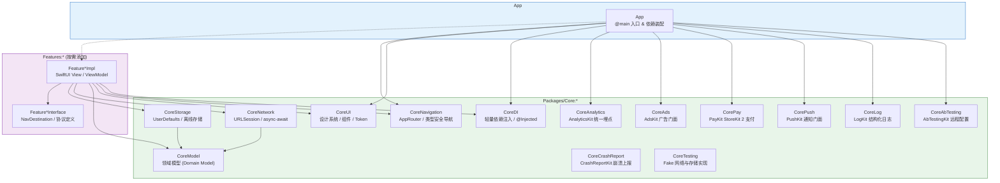
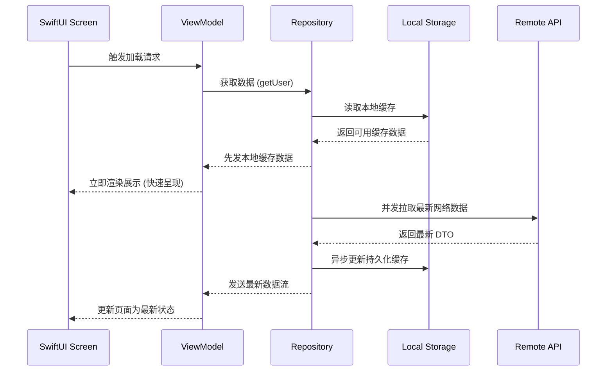

# iOS 现代模块化架构模板 (iOS Modern Architecture Skeleton)

基于 **SwiftUI** + **Swift 6 结构化并发** + **SPM (Swift Package Manager) 本地三级模块化** 的现代化 iOS 工程骨架模板。

> 离线优先 · 单向数据流 · 类型安全路由 · 零三方侵入依赖注入 · 统一商业化 Kit 门面

---

## 架构拓扑



---

## 技术选型一览

| 领域 | 选型 | 说明 |
| :--- | :--- | :--- |
| **语言 & 编译器** | Swift 6 / 5.10+ | 开启严格并发安全检查（Data-race Safety） |
| **UI 框架** | SwiftUI | 全面声明式，零 UIKit 业务侵入 |
| **状态管理** | `@Observable` / UDF | 单一 UiState 状态流 + 生命周期感知 |
| **依赖注入** | `CoreDI` | 原生轻量依赖容器，支持 `@Injected` 与测试 Fake 替换 |
| **导航路由** | `CoreNavigation` | 基于 `NavigationPath` 的解耦跨模块类型安全路由 |
| **网络层** | `CoreNetwork` | `URLSession` + `async`/`await` + 强类型 Endpoint |
| **本地持久化** | `CoreStorage` | 离线优先策略，UserDefaults / SwiftData 封装 |
| **支付方案** | `CorePay` (PayKit) | 基于原生 `StoreKit 2` 封装的自动续订与凭证监听 |
| **数据统计** | `CoreAnalytics` | 集中事件/参数常量的可插拔埋点门面 |
| **广告聚合** | `CoreAds` | 插屏、激励视频、横幅广告统一调度 |
| **日志输出** | `CoreLog` | Apple 原生 `os.Logger` 结构化日志封装 |
| **测试策略** | Swift Testing / XCTest | 全面手写 Fake 替代动态 Mock |

---

## 快速上手与项目初始化

### 1. 运行初始化脚本
本模板使用占位符 `xxx.yyy.zzz` 和 `Architecture`。创建真实应用时运行：
```bash
./init_project.sh
```
根据提示输入应用名（如 `MyAwesomeApp`）和 Bundle ID（如 `com.mycompany.app`），脚本会自动替换占位符并验证编译。

### 2. 常用命令行操作
```bash
# 编译工程全部模块
swift build

# 运行全量单元测试与集成测试
swift test

# 使用 Xcode 打开工程进行真机/模拟器调试
xed .
```

---

## 模块设计规范

### 1. Feature 模块拆分规范
每个业务功能必须拆分为两部分：
- **`Feature*Interface`**：仅包含导航路由目标 `NavDestination`、服务协议定义、入参模型。对外公开，外部其他模块仅可依赖该 Target。
- **`Feature*Impl`**：包含具体的 Screen 视图、ViewModel、Repository 实现。外部模块严禁直接依赖该 Target。

### 2. 离线优先数据流


---

## 架构决策记录 (ADR)

本项目的所有核心架构选型均记录在 [`docs/adr/`](docs/adr/) 目录：

- [ADR-0001: 使用 SwiftUI 与 Observation 框架作为核心 UI 与状态方案](docs/adr/0001-use-swiftui-and-observation.md)
- [ADR-0002: 使用 Swift Package Manager (SPM) 进行工程模块化拆分](docs/adr/0002-use-spm-for-modularization.md)
- [ADR-0003: Feature 模块 Interface 与 Implementation 隔离设计](docs/adr/0003-feature-interface-impl-split.md)
- [ADR-0004: 原生轻量级依赖注入方案 (CoreDI)](docs/adr/0004-lightweight-dependency-injection.md)
- [ADR-0005: 离线优先（Offline-First）数据缓存策略](docs/adr/0005-offline-first-storage-strategy.md)
- [ADR-0006: 全面采用 Swift 6 现代并发模型 (Structured Concurrency)](docs/adr/0006-modern-concurrency-swift6.md)
- [ADR-0007: 统一商业化与基础设施门面体系 (Commercial Kits)](docs/adr/0007-unified-commercial-kits.md)
- [ADR-0008: 测试策略：全面使用手写 Fake 替代动态 Mock](docs/adr/0008-fake-over-mock-testing.md)

详细开发规则与代码约定请参考 [AGENTS.md](AGENTS.md)。
