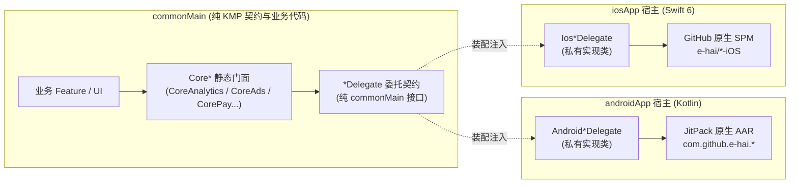

# Kotlin Multiplatform (KMP) 跨平台架构基线

> **基线定位**：对齐 JetBrains 2026 最新官方规范 **[A New Default Project Structure for Kotlin Multiplatform](https://blog.jetbrains.com/kotlin/2026/05/new-kmp-default-structure/)** 与 **Android Gradle Plugin (AGP) 9.0** 的工业级跨端架构骨架。

---

## 架构拓扑与目录布局

本工程采用「平台宿主独立外置 + 共享内核模块化」的 2026 最新设计：

```
Architecture/
├── androidApp/                        # [Android 宿主] 纯 Android 原生应用 (com.android.application)
│   ├── src/main/AndroidManifest.xml
│   └── src/main/kotlin/xxx/yyy/zzz/android/
│       ├── MyApplication.kt           # 初始化双端 Kit 与 Koin 全局容器
│       ├── MainActivity.kt            # 挂载 Compose Multiplatform 根视图
│       └── bridge/
│           └── NativeKitBootstrap.kt  # 注入 8 大 Android*Delegate 并调用门面初始化
├── shared/                            # [共享内核根库] 纯 KMP 库 (myproject.kmp.library + CMP)
│   └── src/
│       ├── commonMain/kotlin/xxx/yyy/zzz/shared/
│       │   ├── App.kt                 # Compose Multiplatform 根 Composable
│       │   ├── navigation/            # 跨平台导航路由分发
│       │   └── di/AppBootstrap.kt     # 全局 Koin 依赖注入聚合中心
│       └── iosMain/kotlin/xxx/yyy/zzz/shared/
│           └── MainViewController.kt  # 导出给 iOS 宿主的 UIViewController
├── iosApp/                            # [iOS 宿主] 独立 Swift 6 / Xcode 工程
│   ├── Package.swift                  # 引入 e-hai/*-iOS 8 大 Kit (GitHub SPM)
│   └── Sources/
│       ├── iOSApp.swift               # SwiftUI App 入口
│       └── Bridge/
│           └── NativeKitBootstrap.swift # 注入 8 大 Ios*Delegate 并调用门面初始化
├── core/                              # [Core 基础设施层] 纯 KMP 库
│   ├── model/                         # 领域模型 (@Serializable) 与网络结果契约
│   ├── network/                       # Ktor HTTP Client (OkHttp + Darwin 引擎)
│   ├── database/                      # Room KMP + BundledSQLiteDriver
│   ├── datastore/                     # DataStore Preferences KMP 跨平台键值存储
│   ├── navigation/                    # 跨端类型安全导航状态机 (NavKey / Navigator)
│   ├── ui/                            # Compose Multiplatform Material3 主题与通用组件
│   ├── log/                           # CoreLog 门面 + LogTags (直连 e-hai/LogKit)
│   ├── crashreport/                   # CoreCrashReport 门面 + CrashReportKeys
│   ├── analytics/                     # CoreAnalytics 门面 + Events / Params
│   ├── abtesting/                     # CoreAbTesting 门面 + Keys
│   ├── mmp/                           # CoreMmp 门面 + Events / Params
│   ├── ads/                           # CoreAds 门面 + AdsKeys
│   ├── pay/                           # CorePay 门面 + PayProducts
│   └── push/                          # CorePush 门面 + PushChannels
├── build-logic/                       # Gradle 约定插件 (Convention Plugins)
├── gradle/libs.versions.toml          # Version Catalog 依赖版本目录
├── init_project.sh                    # 一键替换包名与工程名初始化脚本
└── docs/adr/                          # 架构决策记录 (ADR 0000 ~ 0016)
```

---

## KMP 双端 API 调用边界与互操作原理

1. **`androidMain` 调用 Android 官方 API（Kotlin / Java）？**
   - **100% 全部支持，零障碍**。因为 `androidMain` 本质就是编译成 JVM 字节码，无论是 `android.*`（Java）还是 `androidx.*` / Jetpack（Kotlin），直接 `import` 即可。
2. **`androidMain` 调用自定义的 Kotlin / Java API 需要特殊处理吗？**
   - **不需要任何特殊处理**。无论是同模块下的 `.kt`/`.java` 文件，还是通过 Gradle `implementation` 引入的自定义/第三方 `.jar`、`.aar`，字节码天然互通（唯一限制仅在于 Gradle 模块不能反向依赖顶层 `androidApp` 壳工程）。
3. **`iosMain` 能调用所有的 iOS 官方 API（包括 Swift 或 Objective-C）吗？**
   - **不能调用全部！** `kotlinc-native` 内置的 `platform.*` 仅通过 `cinterop` 绑定了系统 **C 和 Objective-C 头文件（`.h`）**（如 `Foundation`、`UIKit`）。对于 Apple 近年来推出的**纯 Swift 官方框架**（如 `SwiftUI`、`StoreKit 2`、`CryptoKit`、`SwiftData`、`TipKit`），由于没有 Obj-C 头文件，`iosMain` **物理上完全不可见、无法直接调用**。
4. **`iosMain` 调用自定义的 Swift 或 Objective-C API 需要特殊处理吗？**
   - **需要特殊处理，且难度差异巨大**：
     - **自定义 Objective-C / C**：需要编写 `.def` 文件并在 Gradle 中配置 `cinterop`（或通过 CocoaPods 插件），让编译器把 `.h` 头文件翻译成 Kotlin 存根后才能调用。
     - **自定义 Swift（或纯 Swift SPM 库）**：`iosMain` **完全无法直接调用**。若强行用 `expect/actual`，必须把 Swift 代码加上 `@objc` 并阉割掉所有纯 Swift 特性（Struct/泛型/枚举关联值），先用 Xcode 打成带 `*-Swift.h` 的 XCFramework 再配 Gradle `cinterop`；**正因这条路极度繁琐脆弱，凡涉及纯 Swift（官方或自定义），本质上都倒逼架构放弃 `expect/actual`，改用 `interface` + 运行期依赖注入（在 Swift 宿主中实现接口并注入回 KMP）**。

---

## 八大商业化 Kit 跨平台接入架构

针对 `e-hai` 旗下 8 大双端原生库（Android 为 JitPack AAR，iOS 为 GitHub SPM），采用 **1:1 全原生透传门面** 机制：



- **零命名冲突**：门面统一使用 `Core*` 前缀，Android 端彻底告别 `as` 别名，iOS 端彻底告别 `Shared.` 前缀消歧；
- **原生 SDK 物理隔离**：全工程唯一调用原生 AAR / SPM API 的地方严格限制在双端宿主私有的 `*Delegate` 实现内部；
- **零学习成本**：业务调用语法与 `android` / `ios` 原生分支 100% 一致；
- **零性能损耗**：底层 1:1 单行透传直达原生 SDK；
- **支持 Fake 测试**：内部 Delegate 机制满足「Fake over Mock」全平台铁律，单测无需任何 Mock 框架。

---

## 快速开始

### 1. 一键初始化项目包名
```bash
./init_project.sh
```
按照命令行提示输入新的包名（如 `com.mycompany.myapp`），脚本会自动重命名所有命名空间与物理目录。

### 2. 构建与运行

#### Android 端
```bash
./gradlew :androidApp:assembleDevDebug
```

#### iOS 端
```bash
./gradlew :shared:compileKotlinIosSimulatorArm64
```
或直接使用 Xcode 打开 `iosApp` 目录构建运行。

### 3. 代码格式化与规范检查
```bash
./gradlew spotlessApply
./gradlew spotlessCheck
```
