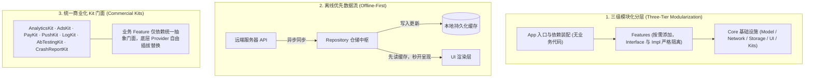

# Architecture · 现代移动端多平台架构工程中枢

本仓库致力于为移动端工程提供工业级、离线优先、三级模块化的高标准架构脚手架与最佳实践。针对不同的技术路线与业务形态，核心实现分别收敛并独立维护在对应的分支中：

- **[`android`](https://github.com/e-hai/Architecture/tree/android)**：Android 原生现代架构（基于 Now in Android 范式）
- **[`ios`](https://github.com/e-hai/Architecture/tree/ios)**：iOS 原生现代架构（SwiftUI + Swift 6 并发 + SPM 模块化）
- **[`kmp`](https://github.com/e-hai/Architecture/tree/kmp)**：Kotlin Multiplatform + Compose Multiplatform 跨平台架构

---

## 多端架构技术选型矩阵

各平台在遵循统一架构设计哲学的前提下，深度拥抱平台原生最佳实践：

| 维度 / 架构层 | Android 原生 (`android`) | iOS 原生 (`ios`) | 跨平台跨端 (`kmp`) |
| :--- | :--- | :--- | :--- |
| **编程语言** | Kotlin 2.x | Swift 6 / 5.10+ | Kotlin Multiplatform |
| **异步并发** | `kotlinx.coroutines` (Flow) | 结构化并发 (`async`/`await`, Actor) | `kotlinx.coroutines` (Common Flow) |
| **UI 范式** | Jetpack Compose (Material3) | SwiftUI | Compose Multiplatform (CMP) |
| **状态驱动** | `StateFlow<UiState>` + Lifecycle | `@Observable` / UDF 状态流 | `StateFlow<UiState>` 跨端驱动 |
| **模块化管理** | Gradle 约定插件 (`build-logic`) | SPM 本地包 (`Packages/Core`) | Gradle KMP 跨平台模块化 |
| **依赖注入** | Koin 4.x (无反射侵入) | `CoreDI` (原生轻量容器 + `@Injected`) | Koin Multiplatform |
| **统一导航** | Navigation 3 (类型安全路由) | `CoreNavigation` (`NavigationPath`) | Navigation 3 / Voyager 跨端路由 |
| **网络层** | Retrofit + OkHttp + 序列化 | `URLSession` + `async/await` + Endpoint | Ktor Client + kotlinx-serialization |
| **本地持久化** | Room + DataStore (Preferences) | SwiftData / `UserDefaults` 封装 | Room KMP + Multiplatform Settings |
| **离线优先** | Cache-First 流程编排 | Cache-First 流程编排 | Cache-First 跨端通用仓储 |
| **测试规范** | 手写 Fake + Turbine | 手写 Fake + Swift Testing | 手写 Fake + Common Tests |

---

## 统一核心设计哲学

所有分支架构均严格遵循以下四条核心工程原则：



1. **三级模块化与单向依赖**：
   - 严格遵循 `App → Features:Impl → Core:*` 单向依赖链路；
   - 业务 Feature 必须拆分为 `Interface`（外部仅可见的路由 Key 与协议）与 `Impl`（内部实现的 Screen 与 ViewModel），杜绝循环依赖。
2. **离线优先 (Offline-First)**：
   - 数据层先发本地可用缓存，并并发拉取远端同步，保障首屏秒开与弱网可用。
3. **商业化 Kit 门面解耦 (Commercial Kits)**：
   - 将打点（Analytics）、广告（Ads）、支付（Pay）、推送（Push）、日志（Log）、A/B 测试（AbTesting）、崩溃统计（CrashReport）抽象为统一 Kit 门面，业务代码零直接三方 SDK 依赖。
4. **测试规范 (Fake over Mock)**：
   - 全面禁止动态运行时 Mock 框架，统一采用手写强类型 Fake 实现，保障测试可靠性与可读性。

---

## 快速使用指引

各分支均为独立的开箱即用工程骨架，包含一键项目重命名与参数初始化脚本（`init_project.sh`）。

### 1. 获取 Android 现代原生架构
```bash
# 克隆 android 分支
git clone -b android git@github.com:e-hai/Architecture.git MyApp-Android
cd MyApp-Android

# 运行一键初始化脚本，替换命名空间与包名
./init_project.sh

# 编译验证
./gradlew assembleDebug
```

### 2. 获取 iOS 现代原生架构
```bash
# 克隆 ios 分支
git clone -b ios git@github.com:e-hai/Architecture.git MyApp-iOS
cd MyApp-iOS

# 运行一键初始化脚本，替换 Bundle ID 与 App 名称
./init_project.sh

# 编译与单元测试验证
swift test
```

### 3. 获取 KMP 现代跨平台架构
```bash
# 克隆 kmp 分支
git clone -b kmp git@github.com:e-hai/Architecture.git MyApp-KMP
cd MyApp-KMP

# 运行一键初始化脚本
./init_project.sh
```

---

## 分支导航索引

- **[android 分支源码与规则文档](https://github.com/e-hai/Architecture/tree/android)**：查看 Android 约定插件、Compose 规范与详细 ADR。
- **[ios 分支源码与规则文档](https://github.com/e-hai/Architecture/tree/ios)**：查看 iOS SwiftUI 架构规范、StoreKit 2 门面与 SPM 配置。
- **[kmp 分支源码与规则文档](https://github.com/e-hai/Architecture/tree/kmp)**：查看跨端共享代码架构与双端构建体系。
