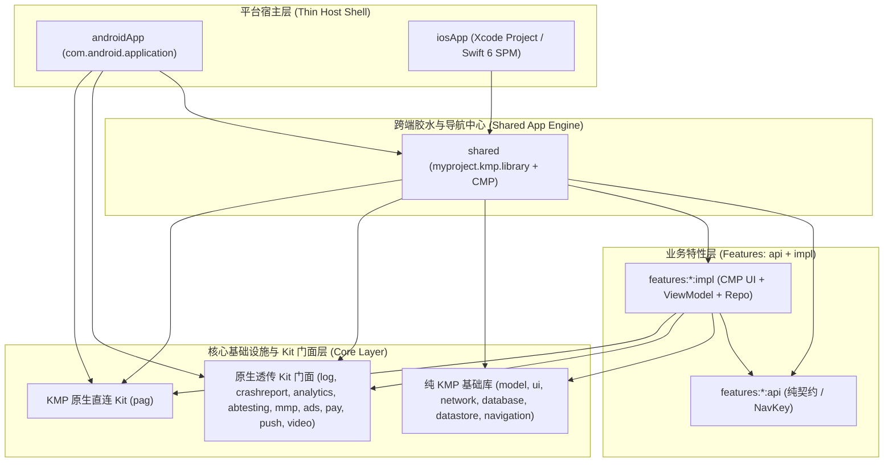
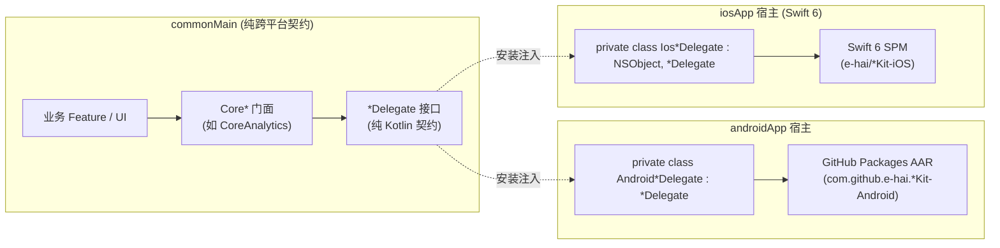
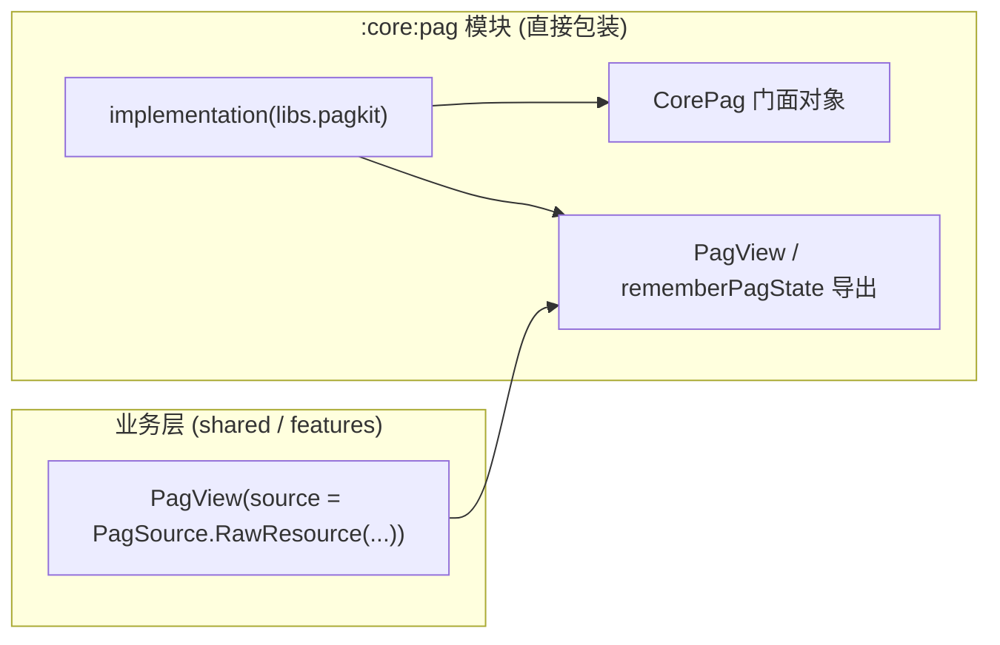
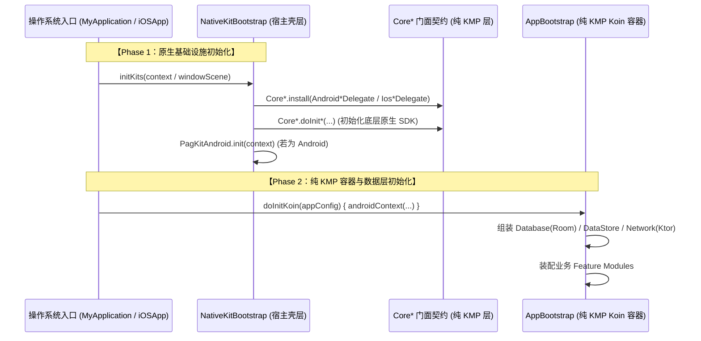

# Kotlin Multiplatform (KMP) 架构设计与技术全景

> **规范基准**：JetBrains 2026 官方推荐结构 (`New Default Project Structure`) + AGP 9.0 + Swift 6 SPM  
> **分支**：`kmp`  
> **核心组件**：Compose Multiplatform (CMP) + Koin + Room KMP + Ktor + 十大基础设施与商业化 Kit

---

## 1. 架构总览与分层设计

工程遵循严格的**三级模块化分层**，确保平台宿主层、跨平台业务层与底层基础设施层单向依赖、权责分明：



### 1.1 三级层次职责

1. **平台宿主层 (`androidApp` / `iosApp`)**：
   - 极薄外壳，声明系统原生入口（Android `Application` / `MainActivity`；iOS `@main struct iOSApp` / `MainViewController`）；
   - 在 `NativeKitBootstrap` 中实现原生 Kit 的私有 Delegate 并注入门面；
   - 依赖底层原生 AAR / Swift SPM 依赖，负责最终打包签名。
2. **跨端胶水层 (`shared`)**：
   - 聚合所有 `features:*` 模块与 `core:*` 模块；
   - 包含根 Composable `App()`、跨特性路由总图 `AppNavGraph.kt` 与依赖注入初始化入口 `AppBootstrap.kt`；
   - 向 iOS 导出 `Shared.framework`。
3. **业务特性层 (`features:*`)**：
   - 严格遵循 `api` 与 `impl` 拆分：
     - `:api`：仅包含供外部调用的契约模型、`NavKey` 路由参数等；
     - `:impl`：包含内部 Composable UI、ViewModel 与 Repository 业务逻辑。
4. **核心基础设施与 Kit 层 (`core:*`)**：
   - **基础库 (6 大纯 KMP 模块)**：`model`、`ui`、`network`、`database`、`datastore`、`navigation`；
   - **十大基础设施与商业化 Kit 模块**：见下文双接入范式说明。

---

## 2. 十大基础设施与商业化 Kit 双接入范式

针对移动端 10 大 Kit，依据底层 SDK 物理形态与跨端成熟度，架构采用两类标准化接入范式：

| Kit 模块 | 接入范式 | `core:*` 目录与形态 | 双端原生 SDK 来源 | 宿主 Delegates 实现 |
| :--- | :--- | :--- | :--- | :--- |
| **`core:log`** | 范式 A (Delegate 透传) | 纯 `commonMain` 门面 + 契约 | GitHub Packages (`LogKit-Android` / `LogKit-iOS`) | `AndroidLogDelegate` / `IosLogDelegate` |
| **`core:crashreport`** | 范式 A (Delegate 透传) | 纯 `commonMain` 门面 + 契约 | GitHub Packages (`CrashReportKit-Android` / `CrashReportKit-iOS`) | `AndroidCrashReportDelegate` / `IosCrashReportDelegate` |
| **`core:analytics`** | 范式 A (Delegate 透传) | 纯 `commonMain` 门面 + 契约 | GitHub Packages (`AnalyticsKit-Android` / `AnalyticsKit-iOS`) | `AndroidAnalyticsDelegate` / `IosAnalyticsDelegate` |
| **`core:abtesting`** | 范式 A (Delegate 透传) | 纯 `commonMain` 门面 + 契约 | GitHub Packages (`AbTestingKit-Android` / `AbTestingKit-iOS`) | `AndroidAbTestingDelegate` / `IosAbTestingDelegate` |
| **`core:mmp`** | 范式 A (Delegate 透传) | 纯 `commonMain` 门面 + 契约 | GitHub Packages (`MmpKit-Android` / `MmpKit-iOS`) | `AndroidMmpDelegate` / `IosMmpDelegate` |
| **`core:ads`** | 范式 A (Delegate 透传) | 纯 `commonMain` 门面 + 契约 | GitHub Packages (`AdsKit-Android` / `AdsKit-iOS`) | `AndroidAdsDelegate` / `IosAdsDelegate` |
| **`core:pay`** | 范式 A (Delegate 透传) | 纯 `commonMain` 门面 + 契约 | GitHub Packages (`PayKit-Android` / `PayKit-iOS`) | `AndroidPayDelegate` / `IosPayDelegate` |
| **`core:push`** | 范式 A (Delegate 透传) | 纯 `commonMain` 门面 + 契约 | GitHub Packages (`PushKit-Android` / `PushKit-iOS`) | `AndroidPushDelegate` / `IosPushDelegate` |
| **`core:video`** | 范式 A (Delegate 透传) | 纯 `commonMain` 门面 + 契约 | GitHub Packages (`VideoKit-Android` / `VideoKit-iOS`) | `AndroidVideoDelegate` / `IosVideoDelegate` |
| **`core:pag`** | 范式 B (KMP 原生直连) | `commonMain` + 平台薄包装 | GitHub Packages (`io.github.e-hai:pagkit`) | **无须 Delegate**（仅宿主做底层环境初始化） |

### 2.1 范式 A：1:1 原生委托透传 (Delegate Passthrough)

适用于纯原生 SDK（如 Android AAR、纯 Swift 6 SPM）：



**设计要点**：
- **100% 纯 `commonMain`**：禁止在 `:core:<kit>` 中创建 `androidMain` 与 `iosMain` 目录；
- **双端绝对隔离**：原生 SDK 依赖仅存在于顶层宿主，跨端代码零原生污染；
- **测试友好**：内置 `Default*Delegate` 兜底实现，单测与 Compose Preview 绝不崩溃。

### 2.2 范式 B：KMP 原生跨平台库直连 (KMP Native Direct)

适用于官方已基于 KMP + CMP 编译好双端二进制（JVM 字节码与 Kotlin/Native `.klib`）的 SDK（以 `PagKit` 为代表）：



**设计要点**：
- 无须声明 `*Delegate` 接口与桥接；
- `:core:pag` 统一封装 `CorePag` 门面及 `PagView` 等跨端 UI 组件；
- 宿主仅需一行底层平台初始化：
  - Android：`NativeKitBootstrap` 中调用 `PagKitAndroid.init(appContext)` 提取原生 `.so`；
  - iOS：Xcode 链接 `libpag.xcframework`。

---

## 3. 双段式冷启动时序 (Two-Phase Cold Boot)

工程严格执行两阶段冷启动，确保原生基础设施先行就绪，KMP 容器随后安全注入：



---

## 4. 依赖管理与 GitHub Packages 分发机制

工程已全面下线 JitPack，所有自研基础设施与商业化 Kit 统一托管于 GitHub Packages：

### 4.1 Maven 仓库统一配置 (`settings.gradle.kts`)

```kotlin
dependencyResolutionManagement {
    repositories {
        google()
        mavenCentral()

        // 统一从 ~/.gradle/gradle.properties 读取 GITHUB_ACTOR 与 GITHUB_TOKEN
        val ghUser = providers.gradleProperty("gpr.user").orNull
            ?: System.getenv("GITHUB_ACTOR") ?: ""
        val ghToken = providers.gradleProperty("gpr.key").orNull
            ?: System.getenv("GITHUB_TOKEN") ?: ""

        val githubKits = listOf(
            "LogKit-Android", "CrashReportKit-Android", "AnalyticsKit-Android",
            "AbTestingKit-Android", "MmpKit-Android", "AdsKit-Android",
            "PayKit-Android", "PushKit-Android", "VideoKit-Android", "PagKit"
        )
        githubKits.forEach { repoName ->
            maven {
                name = "GitHubPackages-$repoName"
                url = uri("https://maven.pkg.github.com/e-hai/$repoName")
                credentials {
                    username = ghUser
                    password = ghToken
                }
            }
        }
    }
}
```

### 4.2 统一版本目录 (`gradle/libs.versions.toml`)

- 移除遗留 `v` 前缀（如 `1.0.1` 替代 `v1.0.1`）；
- 命名空间标准化：
  - Android 原生 Kit：`com.github.e-hai.<RepoName>:<artifactId>:<version>`
  - KMP 原生 Kit：`io.github.e-hai:pagkit:<version>`
  - iOS 端：Swift Package Manager 指向 `https://github.com/e-hai/<RepoName>-iOS.git`

---

## 5. 跨端 API 互操作原则 (Interop First Principles)

1. **Android 端无损互通**：`androidMain` 编译为 JVM 字节码，可直接调用 Android 原生 API 与自定义 AAR，无任何中间阻碍。
2. **iOS 端 Obj-C 与 Swift 边界隔离**：
   - Kotlin/Native 仅通过系统 C/Objective-C 头文件桥接（`platform.*`）；
   - **纯 Swift 6 框架（如 SwiftUI, StoreKit 2）与带有纯 Swift 特性的 SPM 库对 Kotlin/Native 物理不可见**；
   - 架构严禁强行使用残缺的 `@objc expect/actual` 伪互操作，必须坚决采用 **接口契约（Interface）+ 宿主运行期依赖注入（Delegate Pattern）**。

---

## 6. 离线优先与数据流设计 (Offline-First Architecture)

严格遵循 Google **Modern App Architecture** 两层架构规范（UI Layer → Data Layer），杜绝冗余单行透传 UseCase：

- **单向数据流 (UDF)**：ViewModel 暴露不可变 `StateFlow<UiState>`，UI 发送显式 `Intent` 触发状态流转；
- **Cache-First 范式**：Repository 优先通过 Room KMP 观察本地数据，后台异步触发 Ktor 请求刷新本地持久化；
- **领域模型防污染**：网络 DTO 与 Room Entity 严禁外露至 UI 层，必须在 Repository 内部映射为纯领域模型（Domain Model）。
