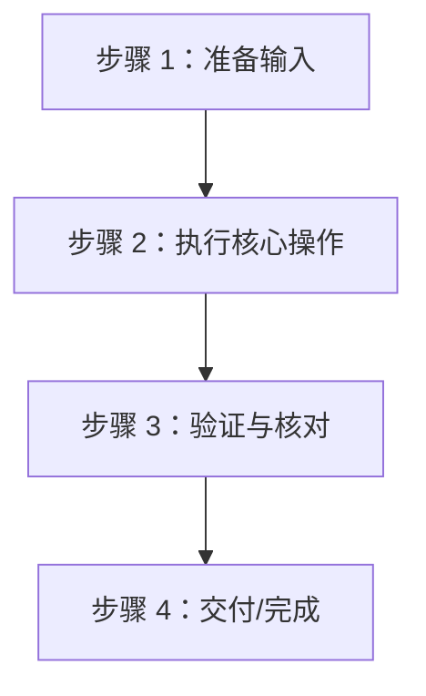

# SOP 0000: [流程名称 / 任务名称]

> **文档版本**：v1.0  
> **适用平台**：Android / iOS / KMP 共享层  
> **责任角色**：移动端开发 / 运维 / 发布管理  

---

## 1. 适用场景与触发时机 (When to Use)
- 简述在什么业务场景或流程节点需要执行本 SOP（例如：新项目立项初始化、版本提审打包、新第三方 SDK 接入等）。

---

## 2. 前置准备与权限检查 (Prerequisites)
- [ ] 硬件/系统环境要求（如 macOS 14+、Xcode 16+、JDK 17+）
- [ ] 账号与权限要求（如 Apple Developer 开发者/管理员权限、Google Play Console 权限）
- [ ] 所需工具安装（如 `keytool`、`xcodegen`）

---

## 3. 核心流程图 (Workflow Diagram)



---

## 4. 分步实操指南 (Step-by-Step Instructions)

### 步骤一：[操作标题]
说明具体操作目的与详细指令：
```bash
# 执行命令示例
command --option value
```

### 步骤二：[操作标题]
说明配置方式、文件位置或后台操作截图点：
1. 打开 `path/to/file`；
2. 修改对应字段。

---

## 5. 验收核对清单 (Verification Checklist)
完成上述操作后，必须通过以下检查确认无误：
- [ ] 检查项 1：本地执行 `./gradlew ...` 编译成功
- [ ] 检查项 2：产物包名与签名指纹核对一致
- [ ] 检查项 3：相关密钥或配置已正确加入 `.gitignore` 或 CI Secrets

---

## 6. 常见踩坑与排障 (Troubleshooting / FAQ)

### Q1: [常见报错描述]？
- **原因**：...
- **解决方法**：...
