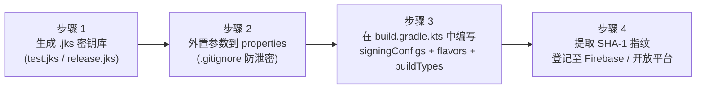

# SOP 0001: Android 与 iOS 双端应用签名与证书管理指南

> **文档版本**：v2.0  
> **适用平台**：Android / iOS 宿主工程  
> **责任角色**：项目主程 / 客户端开发 / 发布管理  

---

## 目录

- [第一部分：双端通用标准签名流程（抛开当前项目）](#第一部分双端通用标准签名流程抛开当前项目)
  - [1.1 双端签名机制核心差异对比](#11-双端签名机制核心差异对比)
  - [1.2 Android 端通用标准流程（常规工程 4 步走）](#12-android-端通用标准流程常规工程-4-步走)
  - [1.3 iOS 端通用标准流程（常规工程标准步骤）](#13-ios-端通用标准流程常规工程标准步骤)
- [第二部分：本项目基于标准流程预置了什么（架构已实现能力）](#第二部分本项目基于标准流程预置了什么架构已实现能力)
  - [2.1 标准步骤与本项目预置实现映射表](#21-标准步骤与本项目预置实现映射表)
  - [2.2 本项目预置的 Android 4 大构建变体 (Build Variants) 映射矩阵](#22-本项目预置的-android-4-大构建变体-build-variants-映射矩阵)
- [第三部分：在本项目中，开发者需要做什么（极简实操清单）](#第三部分在本项目中开发者需要做什么极简实操清单)
  - [3.1 Android 端开发者实操步骤（仅需 3 步，无需修改 Gradle）](#31-android-端开发者实操步骤仅需-3-步无需修改-gradle)
  - [3.2 iOS 端开发者实操步骤](#32-ios-端开发者实操步骤)
  - [3.3 第三方云端后台绑定核对清单](#33-第三方云端后台绑定核对清单)
  - [3.4 验收核对清单 (Verification Checklist)](#34-验收核对清单-verification-checklist)
  - [3.5 常见踩坑与排障 (Troubleshooting / FAQ)](#35-常见踩坑与排障-troubleshooting--faq)

---

## 第一部分：双端通用标准签名流程（抛开当前项目）

在完全脱离具体脚手架或模板项目的前提下，任何原生移动端应用为了在设备上运行、更新和上架，都必须经过签名认证。

### 1.1 双端签名机制核心差异对比

| 对比维度 | 🤖 Android (`.jks` / `.keystore`) | 🍎 iOS (`.p12` + `.mobileprovision`) |
| :--- | :--- | :--- |
| **签发信任机构 (CA)** | **开发者本地自签名（Self-Signed）**，完全离线生成，无需向 Google 申请或审批。 | **Apple 官方 CA 强信任**，必须依赖付费的 Apple Developer 开发者账号。 |
| **产物文件构成** | **单一文件**：`release.jks`（同时包含公钥、私钥与证书别名）。 | **双文件缺一不可**：<br/>1. **`.p12`**（公钥证书与私钥结合体）<br/>2. **`.mobileprovision`**（描述文件/通行证）。 |
| **证书有效期限** | **25 ~ 50 年**（一次生成，应用生命周期内无需更换）。 | **固定 1 年**（每年必须在 Apple 后台续期并重新下载 Provisioning Profile）。 |
| **与包名的物理绑定** | **物理上不绑定**（同一证书可签署任意包名；仅在三方后台通过包名 + SHA-1 建立映射）。 | **物理强绑定**（描述文件严格锁定唯一 Bundle ID 与权限白名单）。 |
| **测试机安装限制** | **零限制**（签名后的 APK 可发送至任意真机直接安装）。 | **严格限制**（Development/Ad Hoc 包仅允许安装在描述文件包含的设备 UDID 上，单账号上限 100 台）。 |
| **能力权限声明 (Capabilities)** | 在 `AndroidManifest.xml` 中声明 `<uses-permission>`。 | 必须在 Apple Developer 后台为 App ID 勾选 Capabilities（如 Push、IAP、Sign in with Apple）并打包进描述文件。 |

---

### 1.2 Android 端通用标准流程（常规工程 4 步走）

在任何一个标准 Android 项目中，为了区分测试环境与正式环境并防止密钥泄露，开发者必须完成以下 4 个标准步骤：



#### 步骤 1：生成 `.jks` 密钥库文件
开发者使用 JDK 自带的 `keytool` 工具在本地生成用于测试和正式发布的两个签名文件：
```bash
# 生成测试证书
keytool -genkeypair -v -keystore test.jks -alias androiddebugkey \
  -keyalg RSA -keysize 2048 -validity 10000 \
  -storepass android -keypass android -dname "CN=Test,O=Android,C=US"

# 生成正式证书（密码自定义，严禁泄露）
keytool -genkeypair -v -keystore release.jks -alias release_key \
  -keyalg RSA -keysize 2048 -validity 10000 \
  -storepass PROD_STORE_PWD -keypass PROD_KEY_PWD -dname "CN=App,O=Company,C=CN"
```

#### 步骤 2：将密钥参数外置到独立属性文件
为了避免将明文密码硬编码进 Gradle 脚本并提交进 Git 仓库，通常会在工程根目录创建 `keystore.properties`（并在 `.gitignore` 中忽略它和 `*.jks`）：
```properties
TEST_STORE_FILE=config/keystore/test.jks
TEST_STORE_PASSWORD=android
TEST_KEY_ALIAS=androiddebugkey
TEST_KEY_PASSWORD=android

PROD_STORE_FILE=config/keystore/release.jks
PROD_STORE_PASSWORD=PROD_STORE_PWD
PROD_KEY_ALIAS=release_key
PROD_KEY_PASSWORD=PROD_KEY_PWD
```

#### 步骤 3：在 `app/build.gradle.kts` 中编写签名与变体绑定逻辑
常规工程中必须在构建脚本中显式配置 4 个核心代码块：
```kotlin
// 1. 读取属性文件
val keystoreProps = Properties().apply {
    val f = rootProject.file("keystore.properties")
    if (f.exists()) f.inputStream().use { load(it) }
}

android {
    // 2. 声明签名配置容器
    signingConfigs {
        create("test") {
            storeFile = rootProject.file(keystoreProps.getProperty("TEST_STORE_FILE"))
            storePassword = keystoreProps.getProperty("TEST_STORE_PASSWORD")
            keyAlias = keystoreProps.getProperty("TEST_KEY_ALIAS")
            keyPassword = keystoreProps.getProperty("TEST_KEY_PASSWORD")
        }
        create("prod") {
            storeFile = rootProject.file(keystoreProps.getProperty("PROD_STORE_FILE"))
            storePassword = keystoreProps.getProperty("PROD_STORE_PASSWORD")
            keyAlias = keystoreProps.getProperty("PROD_KEY_ALIAS")
            keyPassword = keystoreProps.getProperty("PROD_KEY_PASSWORD")
        }
    }

    // 3. 隔离测试包名与正式包名，绑定对应签名
    flavorDimensions += "environment"
    productFlavors {
        create("dev") {
            dimension = "environment"
            applicationId = "com.example.app.dev"
            signingConfig = signingConfigs.getByName("test")
        }
        create("prod") {
            dimension = "environment"
            applicationId = "com.example.app"
            signingConfig = signingConfigs.getByName("prod")
        }
    }

    // 4. 配置编译类型（控制 Release 混淆与 Debug 签名覆盖）
    buildTypes {
        debug {
            signingConfig = signingConfigs.getByName("test")
        }
        release {
            isMinifyEnabled = true
            isShrinkResources = true
            proguardFiles(getDefaultProguardFile("proguard-android-optimize.txt"), "proguard-rules.pro")
        }
    }
}
```

#### 步骤 4：提取证书 `SHA-1` / `SHA-256` 指纹
第三方平台（如 Firebase、Google 登录、微信开放平台）不校验签名密码，而是校验签署该 APK 证书的哈希指纹：
```bash
keytool -list -v -keystore release.jks -alias release_key -storepass PROD_STORE_PWD
```

---

### 1.3 iOS 端通用标准流程（常规工程标准步骤）

在 Xcode 项目中，通用标准流程分为「多环境 Bundle ID 隔离」以及两种签名接入模式：

#### 前提：在 Xcode Build Settings 中隔离多环境 `PRODUCT_BUNDLE_IDENTIFIER`
- `Debug` 配置设定为 `com.example.app.dev`；
- `Release` 配置设定为 `com.example.app`。

#### 模式 A：日常开发联调（Automatic Signing 自动签名 — 3 步）
适合日常开发真机调试，由 Xcode 自动打通 Apple 开发者后台：
1. **登录账号**：打开 `Xcode -> Settings -> Accounts`，添加加入团队的 Apple ID；
2. **启用自动签名**：在工程 Target 的 `Signing & Capabilities` 面板勾选 **`Automatically manage signing`**，选择对应的 **Team**；
3. **连接真机运行**：USB 连接 iPhone 运行，Xcode 会自动向 Apple 后台注册设备 UDID、签发 `Apple Development` 证书，并下载 Provisioning Profile。

#### 模式 B：CI 自动化打包与正式发版（Manual Signing 手动签名 — 5 步）
脱离个人 Xcode 登录环境，向打包机或生产分发时必须按此 5 步操作：
1. **生成 CSR (Certificate Signing Request)**：  
   打开 Mac「钥匙串访问」$\rightarrow$ `证书助理` $\rightarrow$ `从证书颁发机构请求证书...` $\rightarrow$ 保存为 `CertificateSigningRequest.certSigningRequest`（此时本地钥匙串中自动生成配对私钥）。
2. **在 Apple Developer 后台签发证书**：  
   访问 [Certificates 列表](https://developer.apple.com/account/resources/certificates/list) $\rightarrow$ 新增 `Apple Distribution` 证书 $\rightarrow$ 上传第一步的 CSR $\rightarrow$ 下载生成的 `.cer` 文件并双击导入钥匙串。
3. **导出 `.p12` 签名文件**：  
   在钥匙串中找到刚导入的证书，展开选中证书与下属私钥 $\rightarrow$ 右键「导出」$\rightarrow$ 格式选择 `.p12`，输入保护密码。（**该 `.p12` 即等价于 Android 的 `.jks` 文件**，可分发给 CI 打包机）。
4. **注册 App ID 与设备 UDID**：  
   在 [Identifiers](https://developer.apple.com/account/resources/identifiers/list) 中分别添加正式 ID（`com.example.app`）与测试 ID（`com.example.app.dev`），勾选 Capabilities；在 [Devices](https://developer.apple.com/account/resources/devices/list) 中录入测试机 UDID。
5. **生成 `.mobileprovision` 描述文件**：  
   在 [Profiles](https://developer.apple.com/account/resources/profiles/list) 中新建描述文件，选择对应 App ID 与 Distribution 证书，下载生成 `.mobileprovision` 供打包签名。

---

## 第二部分：本项目基于标准流程预置了什么（架构已实现能力）

在本项目中，为了消除重复样板代码并防止误操作，上述第一部分中的绝大多数配置已在底层框架中完成封装。

### 2.1 标准步骤与本项目预置实现映射表

| 所属端 | 通用标准步骤 | 本项目已预置的工程化实现 | 对应源码路径 |
| :--- | :--- | :--- | :--- |
| **Android** | 1. 密钥文件安全忽略 | `.gitignore` 已默认忽略 `keystore.properties`、`*.jks`、`*.keystore`。 | [.gitignore](file:///Users/a/Develop/project/android/Architecture/.gitignore) |
| **Android** | 2. 密钥属性文件模版 | 已提供带字段说明的模板文件。 | [keystore.properties.example](file:///Users/a/Develop/project/android/Architecture/keystore.properties.example) |
| **Android** | 3. Gradle 环境维度声明 | 全局约定插件中已统一注册 `environment` 维度与 `dev`、`prod` 两个 flavor。 | [AndroidApplicationConventionPlugin.kt](file:///Users/a/Develop/project/android/Architecture/build-logic/convention/src/main/kotlin/AndroidApplicationConventionPlugin.kt#L32-L40) |
| **Android** | 4. Gradle 签名逻辑与变体绑定 | 宿主已实现**三级属性读取**与**链式无证书安全降级**机制，自动映射 4 大构建变体。 | [androidApp/build.gradle.kts](file:///Users/a/Develop/project/android/Architecture/androidApp/build.gradle.kts#L7-L86) |
| **iOS** | 5. Xcode 多环境 Bundle ID 隔离 | `iosApp/project.yml` 已配置 `Debug` 对应 `APP_ID_DEV`、`Release` 对应 `APP_ID_PROD`。 | [iosApp/project.yml](file:///Users/a/Develop/project/android/Architecture/iosApp/project.yml#L24-L32) |
| **双端** | 6. 一键全局包名替换 | `./init_project.sh` 可一键将双端默认包名重命名为业务正式包名与测试包名。 | [init_project.sh](file:///Users/a/Develop/project/android/Architecture/init_project.sh) |

> [!NOTE]
> **关于 Android 端三级属性读取与链式降级保护：**
> 在 [androidApp/build.gradle.kts](file:///Users/a/Develop/project/android/Architecture/androidApp/build.gradle.kts) 中：
> 1. 读取属性时按 `keystore.properties`（本地优先）$\rightarrow$ `System.getenv()`（CI 流水线兜底）$\rightarrow$ 默认值三级检索；
> 2. 当 `release.jks` 未配置时，`prod` 签名自动降级为 `test`；当 `test.jks` 也未配置时，自动降级为系统 `~/.android/debug.keystore`。新拉取代码的开发者**在没有配证书的情况下也能直接编译运行**，不会抛出 Gradle 构建异常。

---

### 2.2 本项目预置的 Android 4 大构建变体 (Build Variants) 映射矩阵

基于上述预置配置，Gradle 会自动组合生成以下 4 个构建变体，其行为完全受控：

| 构建变体 (Build Variant) | 触发打包命令 | 生效 `applicationId` | 生效签名配置 | 证书缺失时的回退策略 | R8 混淆与资源压缩 | 适用场景 |
| :--- | :--- | :--- | :--- | :--- | :--- | :--- |
| **`devDebug`** | `./gradlew :androidApp:assembleDevDebug` | `APP_ID_DEV` (`*.dev`) | `test` (`test.jks`) | 回退到系统 `debug.keystore` | ❌ 关闭 | **日常开发与断点联调**（Android Studio 默认选择） |
| **`devRelease`** | `./gradlew :androidApp:assembleDevRelease` | `APP_ID_DEV` (`*.dev`) | `test` (`test.jks`) | 回退到系统 `debug.keystore` | ✅ 开启 | **测试环境混淆验证**（验证 ProGuard 规则是否误杀反射/序列化类） |
| **`prodDebug`** | `./gradlew :androidApp:assembleProdDebug` | `APP_ID_PROD` (正式) | `test` (`test.jks`) | 回退到系统 `debug.keystore` | ❌ 关闭 | **正式包名本地调试**（需要正式包名测试特定三方回调时使用） |
| **`prodRelease`** | `./gradlew :androidApp:assembleProdRelease`<br/>或 `bundleProdRelease` | `APP_ID_PROD` (正式) | `prod` (`release.jks`) | 依次降级为 `test` $\rightarrow$ `debug` | ✅ 开启 | **生产环境发版与上架 Google Play** |

---

## 第三部分：在本项目中，开发者需要做什么（极简实操清单）

因为大部分底层配置已封装完毕，在日常项目初始化与发布配置中，**开发者完全不需要修改任何 Gradle 代码**，仅需完成以下必要操作：

### 3.1 Android 端开发者实操步骤（仅需 3 步，无需修改 Gradle）

#### 第一步：生成双端测试与正式签名证书
在项目根目录运行以下命令，证书存放在 `config/keystore/` 下：
```bash
mkdir -p config/keystore

# 1. 生成团队共享测试证书（固定开发环境 SHA-1，供全员联调）
keytool -genkeypair -v \
  -keystore config/keystore/test.jks \
  -alias androiddebugkey \
  -keyalg RSA -keysize 2048 -validity 10000 \
  -storepass android -keypass android \
  -dname "CN=Android Debug,O=Android,C=US"

# 2. 生成高保密正式发版证书（请替换为高强度正式密码，严禁提交进 Git 仓库）
keytool -genkeypair -v \
  -keystore config/keystore/release.jks \
  -alias release_key \
  -keyalg RSA -keysize 2048 -validity 10000 \
  -storepass YOUR_PROD_STORE_PASSWORD -keypass YOUR_PROD_KEY_PASSWORD \
  -dname "CN=YourApp,OU=Mobile,O=YourCompany,L=City,S=State,C=CN"
```

#### 第二步：复制并填写 `keystore.properties`
```bash
cp keystore.properties.example keystore.properties
```
编辑 `keystore.properties`：
```properties
APP_ID_PROD=com.example.myapp
APP_ID_DEV=com.example.myapp.dev

TEST_STORE_FILE=config/keystore/test.jks
TEST_STORE_PASSWORD=android
TEST_KEY_ALIAS=androiddebugkey
TEST_KEY_PASSWORD=android

PROD_STORE_FILE=config/keystore/release.jks
PROD_STORE_PASSWORD=YOUR_PROD_STORE_PASSWORD
PROD_KEY_ALIAS=release_key
PROD_KEY_PASSWORD=YOUR_PROD_KEY_PASSWORD
```

#### 第三步：提取 `SHA-1` 与 `SHA-256` 指纹
```bash
# 查看测试证书指纹
keytool -list -v -keystore config/keystore/test.jks -alias androiddebugkey -storepass android

# 查看正式证书指纹
keytool -list -v -keystore config/keystore/release.jks -alias release_key -storepass YOUR_PROD_STORE_PASSWORD
```

> [!IMPORTANT]
> **什么时候才需要开发者手动修改 [androidApp/build.gradle.kts](file:///Users/a/Develop/project/android/Architecture/androidApp/build.gradle.kts)？**
> 仅在以下 3 种进阶扩展场景下才需要改动：
> 1. **定制测试版本名后缀**：例如希望测试包在系统应用信息中显示 `1.0.0-dev`，在 `productFlavors.named("dev")` 中增加 `versionNameSuffix = "-dev"`；
> 2. **增加第三个环境**：需要新增预发（`staging`）环境时，在 `AndroidApplicationConventionPlugin.kt` 和 `androidApp/build.gradle.kts` 中同步添加 `staging` flavor；
> 3. **定制签名方案版本**：需要强制开关 V1/V2/V3 方案时在 `signingConfigs` 显式声明。

---

### 3.2 iOS 端开发者实操步骤

1. **日常开发联调（Xcode 自动签名）**：
   - 在 [iosApp/project.yml](file:///Users/a/Develop/project/android/Architecture/iosApp/project.yml) 中填入你所属的 10 位 Apple Developer Team ID：
     ```yaml
     DEVELOPMENT_TEAM: "YOUR_10_DIGIT_TEAM_ID"
     ```
   - 重新生成 Xcode 工程：
     ```bash
     cd iosApp && xcodegen generate --spec project.yml
     ```
   - 打开 Xcode 连上 iPhone 直接运行。
2. **CI 打包与正式上架**：
   - 按照第一部分 [1.3 模式 B](#模式-bci-自动化打包与正式上架manual-signing-手动签名--5-步) 手动在 Apple 后台创建 `Apple Distribution` 证书导出 `.p12`，并生成发布描述文件 `.mobileprovision` 注入打包机。

---

### 3.3 第三方云端后台绑定核对清单

生成双端正式与测试签名后，将参数同步至各云服务后台：

- [ ] **Firebase 控制台**：
  - 分别创建 `dev` 与 `prod` 两个 Firebase 项目；
  - 在 Android 应用设置中录入 `test.jks` 与 `release.jks` 的 **`SHA-1` 指纹**；
  - 下载配置文件放置在对应位置：
    - Android: `androidApp/src/dev/google-services.json` 与 `androidApp/src/prod/google-services.json`
    - iOS: `iosApp/iosApp/GoogleService-Info-Dev.plist` 与 `GoogleService-Info-Prod.plist`
- [ ] **AppsFlyer / 广告归因后台**：
  - 分别登记测试包名与正式包名，记录分配的 Dev Key；
- [ ] **Google Play Console / App Store Connect**：
  - 创建正式应用条目，配置与 `:core:pay` (`PayProducts.kt`) 对齐的应用内购商品 ID（In-App Purchase / Subscription）。

---

### 3.4 验收核对清单 (Verification Checklist)

配置完毕后，通过执行以下命令验证签名机制是否正常工作：

- [ ] **Android 测试包构建**：`./gradlew :androidApp:assembleDevDebug` 成功输出 APK；
- [ ] **Android 混淆包构建**：`./gradlew :androidApp:assembleDevRelease` 成功构建并使用测试签名；
- [ ] **Android 正式包构建**：配置了 `release.jks` 后运行 `./gradlew :androidApp:assembleProdRelease` 成功构建；
- [ ] **安全隔离校验**：运行 `git status` 确认 `keystore.properties`、`*.jks`、`*.p12`、`*.mobileprovision` 均未出现在 Git 跟踪列表中；
- [ ] **iOS 工程校验**：运行 `(cd iosApp && xcodegen generate --spec project.yml)` 成功生成并在 Xcode 中验证 `Debug` 与 `Release` 的 Bundle ID 正确隔离。

---

### 3.5 常见踩坑与排障 (Troubleshooting / FAQ)

#### Q1: Android 端第三方登录（如 Google Sign-In）报 12500 或 10 错误？
- **排查**：本地当前安装运行的 APK 签名的 `SHA-1` 与 Firebase / Google Cloud 控制台登记的 `SHA-1` 不匹配。
- **解决**：运行 `keytool -list -v -keystore <使用的jks>` 确认 SHA-1，并将其复制到 Firebase 后台「项目设置 -> 您的应用 -> SHA 证书指纹」中。

#### Q2: iOS 真机安装 Ad Hoc 测试包提示 "Untrusted Developer" 或无法安装？
- **排查**：该测试 iPhone 的设备 UDID 未包含在当前打包所用的 `.mobileprovision` 描述文件中。
- **解决**：在 Apple Developer 后台 Devices 列表中添加该 iPhone 的 UDID，重新生成描述文件并打包。

#### Q3: 为什么同一个 Android `.jks` 证书可以签署不同包名的 App？
- **原理**：Android 的 `.jks` 属于开发者个人公私钥签名，在物理机制上不限制被签名的应用包名；限制包名的是应用商店（如 Google Play）与第三方开放平台（它们建立的是「应用包名 + 签名 SHA-1 指纹」的联合唯一绑定）。
