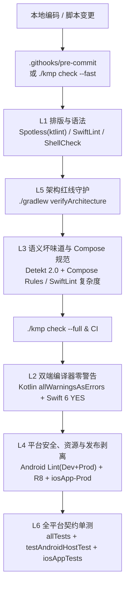

# SOP 0002: 全链路代码质量检测与静态分析标准作业程序

> **文档版本**：v1.0  
> **适用平台**：Android / iOS / KMP 共享层 / 自动化脚本  
> **责任角色**：移动端开发 / 架构守护 / CI 维护  

---

## 1. 适用场景与触发时机 (When to Use)
- 开发者在本地完成业务特性、Core 门面、iOS Delegate 或 Gradle 脚本改动后，执行 `git commit` 前后；
- 执行 `./kmp feature add/remove`、`./kmp kit remove`、`./kmp init` 增删或重构模块之后；
- 任何代码合入 `main` 分支触发 GitHub Actions CI 之前与发版提审前校验。

---

## 2. 前置准备与权限检查 (Prerequisites)
- [ ] macOS 14+ / Xcode 16+ / JDK 17+（CI Runner：`macos-15`）
- [ ] 已安装本地静态分析命令行工具：
  ```bash
  brew install swiftlint shellcheck xcodegen
  ```
- [ ] 已激活仓库内置提交前质量拦截 Hook（一键命令）：
  ```bash
  ./kmp check --install-hooks
  ```

---

## 3. 六维代码质量防御体系全景 (L1 ~ L6)



### 各层级工具与配置文件对照表

| 层级 | 工具/任务 | 核心配置文件 | 职责边界 |
| :--- | :--- | :--- | :--- |
| **L1** | `Spotless 8.5.1` + `ktlint` | [`.editorconfig`](../../.editorconfig)、[`SpotlessConventionPlugin.kt`](../../build-logic/convention/src/main/kotlin/SpotlessConventionPlugin.kt) | Kotlin 与 Gradle DSL 缩进、导入顺序、通配符导入与行宽格式化 |
| **L1/L3** | `SwiftLint 0.65.1` (`--strict`) | [`iosApp/.swiftlint.yml`](../../iosApp/.swiftlint.yml) | iOS `Sources`/`Tests` 排版、圈复杂度（12/20）、函数长度（60/100）、强制解包/弱委托/隐式可选/`unowned`/`fatalError` 拦截与自定义 `no_raw_print_or_nslog` 禁裸日志 |
| **L1** | `ShellCheck 0.11.0` | `./kmp`、`scripts/internal/*.sh`、`scripts/hooks/*.sh`、`.githooks/pre-commit` | Bash 脚手架与构建 Hook 脚本（含 `copy_ios_firebase_plist.sh` / `upload_ios_dsym.sh`）未引用变量、转义与跨平台兼容性检查 |
| **L2** | Kotlin & Swift 6 编译器 | [`KotlinConfiguration.kt`](../../build-logic/convention/src/main/kotlin/project/KotlinConfiguration.kt)、[`iosApp/project.yml`](../../iosApp/project.yml) | Kotlin JVM/KMP/K-N `allWarningsAsErrors = true`；Xcode `SWIFT_TREAT_WARNINGS_AS_ERRORS: "YES"` |
| **L3** | `Detekt 2.0.0-alpha.3` + `Compose Rules 0.6.8` | [`DetektConfiguration.kt`](../../build-logic/convention/src/main/kotlin/project/DetektConfiguration.kt)、[`config/detekt/detekt.yml`](../../config/detekt/detekt.yml) | 22 个模块全源集（`src/**`）圈复杂度、长函数、`GlobalCoroutineUsage`、`UnsafeCallOnNullableType`、`UnstableCollections`（配合 `ImmutableList`/`ImmutableSet`）与 Compose 最佳实践 |
| **L4** | `Android Lint` | [`config/lint/lint.xml`](../../config/lint/lint.xml) | `lintDevDebug` & `lintProdRelease`（`warningsAsErrors = true`、`abortOnError = true`） |
| **L5** | `verifyArchitecture` | [`ArchitectureVerificationPlugin.kt`](../../build-logic/convention/src/main/kotlin/ArchitectureVerificationPlugin.kt) | 11 大架构红线：9 大 Kit 纯 `commonMain`、双端原生 SDK 隔离、单向依赖、Fake over Mock、AGP 9.0 防回退、`doInit*` Obj-C 导出防改名、禁绕过 `CoreLog` 裸打日志、双端 Delegate 对称性、Feature 禁直引 DTO/Entity、Swift 可见 `suspend`/`throw` 强制 `@Throws` 契约 |
| **L6** | `./kmp check` & CI | [`kmp`](../../kmp)、[`scripts/internal/check_quality.sh`](../../scripts/internal/check_quality.sh)、[`.github/workflows/ci.yml`](../../.github/workflows/ci.yml) | 统一本地秒级拦截（`--fast`）与完整双端发版验证（`--full`） |

---

## 4. 分步实操指南 (Step-by-Step Instructions)

### 步骤一：首次拉取仓库后开启 Git 提交前自动检查
```bash
./kmp check --install-hooks
```

### 步骤二：日常开发与提交前（5~8 秒极速静态拦截）
```bash
# 运行 ShellCheck + Python/JS 自检 + 架构红线校验 + Spotless + Detekt + SwiftLint
./kmp check --fast

# 若仅存在格式排版问题，一键自动修复：
./kmp check --fix
```

### 步骤三：重大重构或提审合入前（全量双端验证）
```bash
# 完整执行静态门禁 + 全平台单测 + Android Dev/ProdRelease Lint & R8 APK + iOS Simulator 测试与 Prod 构建
./kmp check --full
```

---

## 5. 验收与豁免原则 (Verification & Exemption Policy)
1. **禁止全局禁用规则**：不得在 `detekt.yml`、`lint.xml` 或 `.swiftlint.yml` 中关闭全局安全/缺陷规则；仅允许针对跨端工程惯例做局部微调（如放行 `@Composable` 大驼峰命名、忽略已托管的依赖升级巡检 `GradleDependency`）。
2. **局部 `@Suppress` 必须附带中文说明**：例如释放/裁剪桩 `DebugPanelBridge.kt` 或第三方 SDK 兜底 `catch (t: Throwable)` 时，必须精准到具体规则名并写明工程原因。
3. **架构红线零豁免**：`verifyArchitecture` 涉及的十一项红线（范式 A 隔离、Android/iOS 双端原生 SDK 隔离、模块单向依赖、Fake over Mock、AGP 9 规范、Obj-C `doInit*` 命名、禁绕过 `CoreLog` 裸打日志、双端 Delegate 对称性、Feature 数据层 DTO/Entity 边界、Swift 可见 API 强制 `@Throws` 契约）不允许绕过。

---

## 6. 常见踩坑与排障 (Troubleshooting / FAQ)

### Q1: Detekt 提示 `ModifierMissing` 或 `ComposableParamOrder`？
- **原因**：公开 `@Composable` 函数发射了 UI 却没有 `modifier: Modifier = Modifier` 参数，或可选 `modifier` 未排在带默认值参数最前。
- **解决方法**：参照参数标准顺序：`无默认值必选参数` → `modifier: Modifier = Modifier` → `其余带默认值可选参数` → `尾随内容 lambda`。

### Q2: 为什么 `NativeKitBootstrap.kt` 等文件保留 `@file:Suppress("ktlint:standard:import-ordering")`？
- **原因**：`scripts/internal/manage_kit.sh` 依赖 `// [KIT:<name>:START]...[KIT:<name>:END]` 锚点按 Kit 分组增删导入；若启用导入字母重排会打乱锚点区间，因此仅对该文件精确豁免 `import-ordering`。

### Q3: 为什么 Kotlin/Native 新增 `init*` 方法后 iOS Swift 编译报错找不到该方法？
- **原因**：Kotlin/Native 导出 Objective-C 头文件时会自动将 `init...` 开头方法识别为构造器并改名或隐藏。
- **解决方法**：跨端门面与 `AppBootstrap` 初始化方法统一严格使用 **`doInit*`** 命名（如 `doInitDeferredKits()`）。
