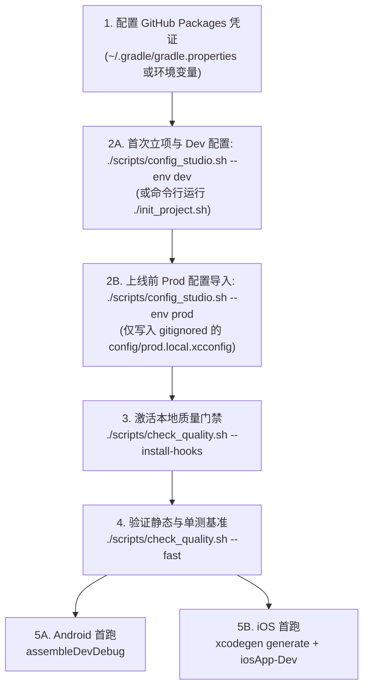

# SOP 0003: 新项目立项初始化与双端开发环境搭建指南

> **文档版本**：v1.0  
> **适用平台**：Android / iOS / KMP 共享层  
> **责任角色**：移动端主程 / 新成员研发  

---

## 1. 适用场景与触发时机 (When to Use)
- 基于本脚手架新开独立项目，需要一键替换 `xxx.yyy.zzz` 包名、`myproject` 插件前缀与双端应用 ID；
- 新成员首次克隆仓库，在本地 macOS 上搭好 JDK / Xcode / GitHub Packages 凭证并完成首次运行与测试。

---

## 2. 前置准备与权限检查 (Prerequisites)
- [ ] **基础环境**：macOS 14+、Xcode 16+、JDK 17+（推荐 Zulu 17 或 Android Studio JBR 17）、Android Studio；
- [ ] **命令行工具**（Homebrew 一键安装）：
  ```bash
  brew install xcodegen swiftlint shellcheck
  ```
- [ ] **GitHub Packages 读取权限**：已具备访问 `e-hai/*` Maven 制品库的 GitHub 账号与只读 Personal Access Token (PAT，至少勾选 `read:packages`)；
- [ ] **Swift Package Git 访问**：已配好 GitHub SSH Key 或 HTTPS Credential，能够拉取 `https://github.com/e-hai/*-iOS.git`。

---

## 3. 核心流程图 (Workflow Diagram)



---

## 4. 分步实操指南 (Step-by-Step Instructions)

### 步骤一：配置 GitHub Packages 读取凭证（严禁明文入库）
参考 [`settings.gradle.kts`](../../settings.gradle.kts)，Gradle 会依次从 `~/.gradle/gradle.properties` 与环境变量读取私有/GitHub Packages 凭证。推荐使用全局 `~/.gradle/gradle.properties`：
```properties
gpr.user=<你的_GitHub_用户名>
gpr.key=<你的_GitHub_PAT_含_read:packages>
```
或临时通过环境变量注入 CI/Shell：
```bash
export GITHUB_ACTOR="<你的_GitHub_用户名>"
export GITHUB_TOKEN="<你的_GitHub_PAT>"
```

### 步骤二：新项目一键立项初始化（仅新开独立项目时执行）

#### 方式 0（推荐，可视化本地直写）：零依赖 Web Config Studio（双端单一真源 + Dev/Prod 物理隔离）
工程采用统一配置文件格式（[`config/dev.xcconfig`](../../config/dev.xcconfig) 与 [`config/prod.xcconfig`](../../config/prod.xcconfig)），由 Android Gradle 与 iOS Xcode 原生直读，**无需中间转换脚本**，同时提供本机启动的网页配置台（[`scripts/config_studio.sh`](../../scripts/config_studio.sh) + [`tools/config-studio/index.html`](../../tools/config-studio/index.html)）：
1. **严格按 `--env` 启动本地直写服务**：执行以下命令后自动在浏览器打开 `127.0.0.1` 配置台并物理锁定目标环境：
   - **首次立项与 Dev 配置**：执行 `./scripts/config_studio.sh --env dev`，可一站式完成项目重命名/Kit 裁剪、修改 [`config/dev.xcconfig`](../../config/dev.xcconfig) 及拖拽上传校验 Dev Firebase 配置；
   - **上线前 Prod 导入**：执行 `./scripts/config_studio.sh --env prod`，仅展示并写入被 `.gitignore` 忽略的 `config/prod.local.xcconfig` 与 Prod Firebase 配置，不触碰任何 Dev 文件或仓库模板；
```bash
# --- 阶段 A：首次立项与 Dev 配置（Dev 环境隔离） ---
./scripts/config_studio.sh --env dev

# --- 阶段 B：正式发版录入（Prod 环境隔离，仅写入 prod.local.xcconfig） ---
./scripts/config_studio.sh --env prod
```
2. **安全与隔离红线**：
   - **Android 签名机密零暴露**：`ANDROID_STORE_FILE`、`ANDROID_STORE_PASSWORD`、`ANDROID_KEY_ALIAS`、`ANDROID_KEY_PASSWORD` 绝不出现在 Web 界面或接口返回中，仍按 [SOP 0001](./0001-app-signing-and-certificates.md) 由 `./scripts/gen_keystore.sh --write-prod-config` 或 CI Secret 单独注入；
   - **强制环境校验**：跨环境请求被 HTTP 403 直接拦截；在 Prod 环境填入 Google 测试广告 ID（`3940256099942544`）、Firebase 包名与 `APP_ID` 不匹配，或混淆 `~` / `/` 广告 ID 时会被立即拦截。

#### 方式 A / B：命令行交互或单行参数初始化
查看 [`init_project.sh`](../../init_project.sh)，亦可使用交互式向导或单行非交互命令，同时支持 `--dry-run` 预演、`--exclude-kits` 裁剪与 `--no-debug` 移除调试台：
```bash
# 方式 A：先预演确认改动
./init_project.sh --package com.acme.news --name "NewsApp" --features "home,feed" --dry-run

# 方式 B：一键完成初始化（独立指定正式/测试 ID 并启用 --yes 非交互）
./init_project.sh \
  --package com.acme.news \
  --app-id com.acme.news \
  --test-app-id com.acme.news.dev \
  --name "NewsApp" \
  --prefix acmenews \
  --features "home,feed,profile" \
  --yes
```
> 若当前目录不再包含 `xxx/yyy/zzz` 模板源码且确实需要重跑，可追加 `--force`。初始化时也会自动挂载 `.githooks/pre-commit`。

### 步骤三：激活 Git 质量 Hook 并运行基础校验
```bash
./scripts/check_quality.sh --install-hooks
./scripts/check_quality.sh --fast
```
首次 Gradle 执行会触发 [`scripts/ensure_libpag_xcframework.sh`](../../scripts/ensure_libpag_xcframework.sh) 下载并缓存 `libpag.xcframework` 至 `.gradle/libpag-ios/`，属正常现象。

### 步骤四：Android 与 iOS 首次本地运行
1. **Android 测试包首跑**：默认配置见双端单一真源 [`config/dev.xcconfig`](../../config/dev.xcconfig)（开箱可跑，未配置签名时回退到系统 debug 签名）：
   ```bash
   ./gradlew :androidApp:assembleDevDebug
   ```
   也可在 Android Studio 直接点击 Run（默认已锁定 `devDebug` 变体）。
2. **iOS 工程生成与首跑**：[`iosApp/project.yml`](../../iosApp/project.yml) 与 [`config/dev.xcconfig`](../../config/dev.xcconfig) / [`config/prod.xcconfig`](../../config/prod.xcconfig) 为单一真源（`iosApp.xcodeproj` 已加入 `.gitignore`）：
   ```bash
   cd iosApp && xcodegen generate --spec project.yml
   ```
   - 如需连接真机运行，可在 [`config/dev.xcconfig`](../../config/dev.xcconfig) 或 Config Studio（`--env dev`）中填写本地 `DEVELOPMENT_TEAM`（个人/公司调试 Team ID）；
   - 如需接入 Firebase，可在 Config Studio 页面直接拖拽上传 `GoogleService-Info.plist`，或手动放入 [`iosApp/Config/Firebase/`](../../iosApp/Config/Firebase/README.md) 的 `Dev/` 与 `Prod/` 子目录（均已 `.gitignore` 且免重跑 `xcodegen`，未放置时自动安全降级）；
   - 使用 Xcode 打开 `iosApp/iosApp.xcodeproj`，选择 Scheme `iosApp-Dev` 运行 Simulator 或真机；或通过命令行测试：
     ```bash
     SIM_UDID=$(xcrun simctl list devices available iPhone | sed -n 's/.*(\([0-9A-F-]\{36\}\)).*/\1/p' | head -n 1)
     xcodebuild -project iosApp.xcodeproj -scheme iosApp-Dev -destination "id=${SIM_UDID}" CODE_SIGNING_ALLOWED=NO test
     ```

---

## 5. 验收核对清单 (Verification Checklist)
- [ ] 全局 `~/.gradle/gradle.properties` 中已配好 `gpr.user`/`gpr.key`，仓库内无任何明文 Token；
- [ ] `./scripts/check_quality.sh --fast` 执行返回 `✔ Fast 静态质量门禁全部通过！`；
- [ ] Android `./gradlew :androidApp:assembleDevDebug` 成功产出 APK；
- [ ] iOS 已生成 `iosApp/iosApp.xcodeproj`，且 `iosApp-Dev` 在模拟器下可正常拉起并运行 `IOSAppTests`（2/2 通过）；
- [ ] 已如实对照 [`AGENTS.md`](../../AGENTS.md) 与 [SOP 0002](./0002-code-quality-and-static-analysis.md) 激活本地 `.githooks/pre-commit`。

---

## 6. 常见踩坑与排障 (Troubleshooting / FAQ)

### Q1: Gradle 报错 `401 Unauthorized` 或找不到 `e-hai/*` 制品？
- **原因**：`~/.gradle/gradle.properties` 未配置 `gpr.user` / `gpr.key`，或 Token 缺少 `read:packages` 权限 / 已过期。
- **解决方法**：核对 Token 权限并重新写入 `~/.gradle/gradle.properties`，随后执行 `./gradlew --refresh-dependencies`。

### Q2: 克隆仓库后 `iosApp/` 下找不到 `iosApp.xcodeproj`？
- **原因**：工程通过 XcodeGen 管理（见 [`iosApp/project.yml`](../../iosApp/project.yml)），`.xcodeproj` 已加入 `.gitignore` 以彻底消除团队合并冲突。
- **解决方法**：在 `iosApp/` 目录下执行 `xcodegen generate --spec project.yml`。每次增删 Swift 文件、SPM 包或更改 plist/resources 后均需重新执行。

### Q3: `./init_project.sh` 或 Config Studio 立项报错 `未找到 xxx/yyy/zzz 模板目录`？
- **原因**：工程之前已执行过初始化替换，脚本默认防重入拦截保护已改包名代码。
- **解决方法**：确认确实要再次重构骨架时在命令行追加 `--force`；若仅需更新 Dev 测试配置或导入 Prod 正式配置，直接使用 `./scripts/config_studio.sh --env dev` / `--env prod` 修改参数即可，不会触动已有包结构。

### Q4: `./scripts/config_studio.sh` 本地校验报错拦截怎么办？
- **常见原因**：
  1. **跨环境污染/误配**：如启动了 `--env dev` 却尝试传入 `env=prod` 请求、或企图在 Prod 环境触发表单初始化；
  2. **正式环境误填测试广告 ID**：在 Prod 配置中填入了 Google 官方测试广告 ID（含 `3940256099942544`；注意 Dev 环境允许填测试 ID），或混淆了 `ANDROID_ADMOB_APP_ID` / `IOS_ADMOB_APP_ID`（`~`）与广告位 ID（`/`）；
  3. **Firebase 包名不匹配或签名红线触碰**：上传的 `google-services.json`（`package_name`）或 `GoogleService-Info.plist`（`BUNDLE_ID`）与当前填写的 `APP_ID` 不一致、未包含正确应用节点，或在非法字段携带 `ANDROID_STORE_*` 签名密码/GitHub Token（`ghp_` / `github_pat_`）。
- **解决方法**：确保 Dev 与 Prod 操作严格分离并按报错提示核对 `APP_ID`、广告 ID 与 Firebase 文件，修正后重新保存即可。
