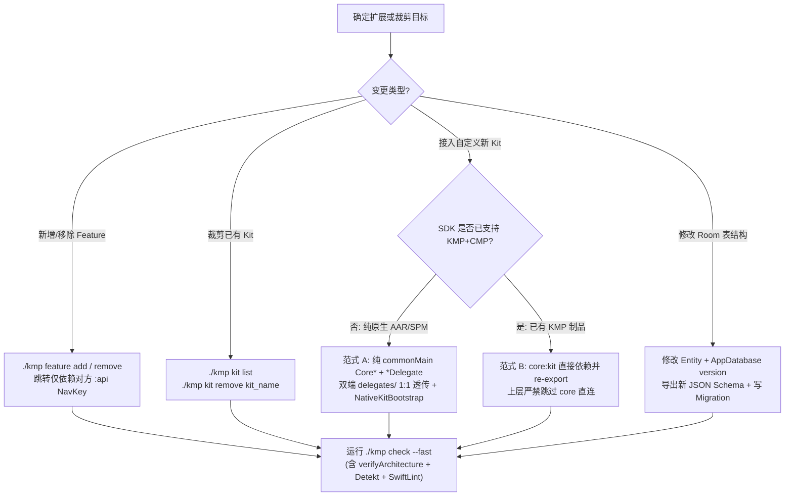

# SOP 0004: 业务特性模块开发、Kit 热插拔与自定义新 Kit 接入指南

> **文档版本**：v1.0  
> **适用平台**：KMP 共享层 / Android / iOS 宿主  
> **责任角色**：移动端业务研发 / 架构维护  

---

## 1. 适用场景与触发时机 (When to Use)
- 新增或安全删除业务 Feature 模块（`:features:<name>:{api,impl}`）；
- 检视或裁剪工程内置的十大基础设施与商业化 Kit（`:core:<kit>`）；
- 按标准双范式为项目接入新的自研或三方原生/跨平台 Kit；
- 修改 Room KMP 实体（`Entity`）并升级数据库版本号及 Schema 快照。

---

## 2. 前置准备与权限检查 (Prerequisites)
- [ ] 已完成 [SOP 0003](./0003-project-init-and-dev-environment.md) 环境配置并通过 `./kmp check --fast`；
- [ ] 已阅读 [`AGENTS.md`](../../AGENTS.md) 中的三级模块化分层与“十大 Kit 跨平台接入双范式”；
- [ ] 已阅读 [`docs/ARCHITECTURE.md`](../ARCHITECTURE.md) 中的离线优先数据流规范。

---

## 3. 核心流程图 (Workflow Diagram)



---

## 4. 分步实操指南 (Step-by-Step Instructions)

### 步骤一：业务特性模块（Feature）创建、裁剪与跨模块跳转
1. **一键生成标准 Feature**（底层脚本见 [`create_feature.sh`](../../scripts/internal/create_feature.sh)）：
   ```bash
   ./kmp feature add profile              # 标准 Screen + ViewModel 模块
   ./kmp feature add profile --with-data  # 额外生成 Offline-First Repository 骨架
   ```
   脚本会自动更新 `settings.gradle.kts`、`shared/build.gradle.kts`、[`AppBootstrap.kt`](../../shared/src/commonMain/kotlin/xxx/yyy/zzz/shared/di/AppBootstrap.kt) 与 [`AppNavGraph.kt`](../../shared/src/commonMain/kotlin/xxx/yyy/zzz/shared/navigation/AppNavGraph.kt)。
2. **跨模块跳转铁律**：若 `home` 跳转到 `profile`，仅允许在 `features/home/impl/build.gradle.kts` 依赖 `implementation(projects.features.profile.api)` 并通过 `@Serializable NavKey` 驱动 `Navigator`；**严禁依赖 `:features:profile:impl`**（由 `verifyArchitecture` 自动阻断）。
3. **安全卸载 Feature**（底层脚本见 [`remove_feature.sh`](../../scripts/internal/remove_feature.sh)）：
   ```bash
   ./kmp feature remove profile
   ```
   若目标模块当前被 [`AppNavGraph.kt`](../../shared/src/commonMain/kotlin/xxx/yyy/zzz/shared/navigation/AppNavGraph.kt) 的 `[START_ROUTE_START/END]` 设为首页或被其他 `:features:*` 引用，脚本会直接拦截并提示解除依赖（极特殊情况可追加 `--force`）。

### 步骤二：十大 Kit 检视与热插拔裁剪
使用 `./kmp kit`（底层脚本见 [`manage_kit.sh`](../../scripts/internal/manage_kit.sh)）管理内置 Kit（移除操作基于 `[KIT:<name>:START]`/`[KIT:<name>:END]` 锚点，并自动折叠多余空行）：
```bash
./kmp kit list               # 查看全部 10 个 Kit 启用状态
./kmp kit remove video       # 一键双端裁剪 Gradle / Kotlin / Swift / DebugSection
```
> 注意：`:core:log` 被核心底座与调试台广泛引用，默认受安全拦截保护；移除任何仍被业务特性依赖的 Kit 时也会先检查引用链。

### 步骤三：新增自定义 Kit 模块（双范式规范）
1. **范式 A（原生 SDK 透传，适用于 Android AAR + iOS Swift/ObjC SDK）**：
   - **纯 `commonMain` 契约**：新建 `:core:<newkit>`（应用 `myproject.kmp.library`），**禁止创建 `androidMain` 与 `iosMain` 目录**；暴露 `Core<NewKit>` 单例、`<NewKit>Delegate` 接口、`Default<NewKit>Delegate` 与常量；
   - **跨端命名规范**：初始化方法必须显式以 **`doInit*`** 命名（例如 `doInit(apiKey: String)`），防止 Kotlin/Native 导出 Objective-C 时把 `init*` 识别为构造器导致改名或丢失；
   - **契约单测先行**：编写手写强类型 `Fake<NewKit>Delegate` 与 `commonTest` 单测（严禁引入 MockK/Mockito）；
   - **双端宿主 1:1 委托**：
     - Android：在 `androidApp/.../bridge/delegates/` 新建 `internal class Android<NewKit>Delegate`；
     - iOS：在 `iosApp/Sources/Bridge/Delegates/` 新建 `internal final class Ios<NewKit>Delegate : NSObject, <NewKit>Delegate`；
     - 在 [`NativeKitBootstrap.kt`](../../androidApp/src/main/kotlin/xxx/yyy/zzz/android/bridge/NativeKitBootstrap.kt) 与 [`NativeKitBootstrap.swift`](../../iosApp/Sources/Bridge/NativeKitBootstrap.swift) 中加注 `// [KIT:<newkit>:START]...[KIT:<newkit>:END]` 锚点并区分 Stage 1（纯本地）或 Stage 2（商业化/网络敏感）；
   - **可选调试区块**：参照 `features/debug/impl/.../sections/` 新增 `<NewKit>DebugSection`，并在 [`DebugModule.kt`](../../features/debug/impl/src/commonMain/kotlin/xxx/yyy/zzz/feature/debug/impl/DebugModule.kt) 注入。
2. **范式 B（KMP + CMP 原生跨平台库，参考 `:core:pag`）**：
   - 参考 [`core/pag/build.gradle.kts`](../../core/pag/build.gradle.kts) 与 [`PagComponents.kt`](../../core/pag/src/commonMain/kotlin/xxx/yyy/zzz/core/pag/PagComponents.kt)，由 `:core:<newkit>` 直接依赖并用门面/组合函数 re-export 对外暴露，业务层严禁直接 `import` 底层三方包。

### 步骤四：Room KMP 数据库 Schema 升级与迁移
1. 修改 [`AppDatabase.kt`](../../core/database/src/commonMain/kotlin/xxx/yyy/zzz/core/database/AppDatabase.kt) 中的 `@Database(entities = [...], version = 2)` 与对应 Entity/Dao；
2. 触发 KSP 编译生成新版本 JSON 快照至 [`core/database/schemas/`](../../core/database/schemas/xxx.yyy.zzz.core.database.AppDatabase/1.json) 同级目录（如 `2.json`）并纳入 Git 版本管理；
3. 若需保留旧版本数据，在 [`DatabaseModule.kt`](../../core/database/src/commonMain/kotlin/xxx/yyy/zzz/core/database/DatabaseModule.kt) 中对 `getDatabaseBuilder()` 统一挂载 `.addMigrations(...)`（无需分别在 [`DatabaseBuilder.android.kt`](../../core/database/src/androidMain/kotlin/xxx/yyy/zzz/core/database/DatabaseBuilder.android.kt) 与 [`DatabaseBuilder.ios.kt`](../../core/database/src/iosMain/kotlin/xxx/yyy/zzz/core/database/DatabaseBuilder.ios.kt) 重复配置），严禁线上直接开启破坏性清库降级；
4. 更新 `commonTest` 与 [`DatabaseBuilderIosTest.kt`](../../core/database/src/iosTest/kotlin/xxx/yyy/zzz/core/database/DatabaseBuilderIosTest.kt) 并重跑 `./gradlew :core:database:allTests`。

---

## 5. 验收核对清单 (Verification Checklist)
- [ ] 新增 `Composable` 页面遵循参数顺序：`无默认值必选参数` → `modifier: Modifier = Modifier` → `可选参数` → `尾随 lambda`；
- [ ] 已补齐或同步更新对应 `commonTest` 与 `Fake*Delegate`，绝无使用运行时 Mock 框架；
- [ ] 运行 `./gradlew verifyArchitecture spotlessCheck detekt allTests` 全部绿灯；
- [ ] 如涉及 `Shared.framework` 对 Swift 暴露接口变更，已重跑 `cd iosApp && xcodegen generate --spec project.yml` 并验证 `iosAppTests`。

---

## 6. 常见踩坑与排障 (Troubleshooting / FAQ)

### Q1: `verifyArchitecture` 报错 `[原生 SDK 泄露]` 或 `[范式 A 违规]`？
- **原因**：在 `features:*`、`shared` 或非 `:core:pag` 的 `core:*` 模块中直接导入了 `io.github.pagkit.*` / `com.kit.*` 等底层包，或在 9 大原生委托 Kit 下创建了 `androidMain`/`iosMain`。
- **解决方法**：将原生 SDK 导入严格下沉至宿主 `delegates/` / `Delegates/` 内部，通过 `Core*` 门面接口通信。

### Q2: `./kmp feature add` 新建的模块在 iOS SwiftUI 页面里点击跳转崩溃或找不到符号？
- **原因**：Xcode 工程尚未触发重编 Kotlin/Native `Shared.framework` 或未加入 Koin 模块。
- **解决方法**：确认 [`create_feature.sh`](../../scripts/internal/create_feature.sh) 已挂载 [`AppBootstrap.kt`](../../shared/src/commonMain/kotlin/xxx/yyy/zzz/shared/di/AppBootstrap.kt) 与 [`AppNavGraph.kt`](../../shared/src/commonMain/kotlin/xxx/yyy/zzz/shared/navigation/AppNavGraph.kt)，然后重新编译 `iosApp-Dev`。

### Q3: 新增 Kit 后运行 `./kmp kit remove <kit>` 漏删了部分引用？
- **原因**：宿主引导器、根目录 `settings.gradle.kts`、`shared/build.gradle.kts` 或 `DebugModule.kt` 中的代码行未包裹在 `// [KIT:<name>:START] ... // [KIT:<name>:END]` 锚点内。
- **解决方法**：核对 [`manage_kit.sh`](../../scripts/internal/manage_kit.sh) 的 `ALL_KITS` 与所有锚点区间命名是否严格一致。
