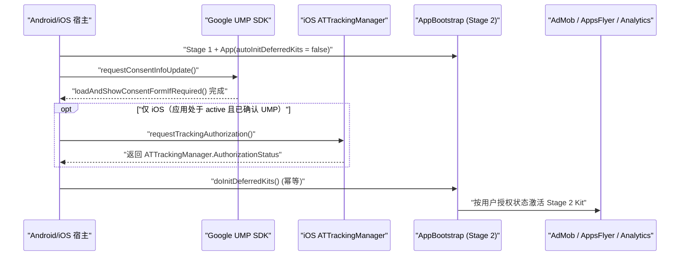

# SOP 0005: 商业化三方 SDK 配置与隐私合规分阶段激活指南

> **文档版本**：v1.0  
> **适用平台**：Android / iOS 宿主 + KMP 共享层  
> **责任角色**：移动端研发 / 商业化接入 / 合规核验  

---

## 1. 适用场景与触发时机 (When to Use)
- 为产品接入真实生产环境的 Firebase、Google AdMob（4 广告位）、AppsFlyer（归因与 DeepLink）、Google Play / App Store 内购商品与远程推送（FCM / APNs）；
- 对接海外出海合规（Google Play + App Store：GDPR/UMP、iOS ATT、`PrivacyInfo.xcprivacy`、`SKAdNetworkItems`），或在国内强合规场景切换“同意隐私协议后再激活三方 SDK”模式。

---

## 2. 前置准备与权限检查 (Prerequisites)
- [ ] 已按 [SOP 0001](./0001-app-signing-and-certificates.md) 完成正式包名、Android Release SHA-1/SHA-256 指纹与 Apple Development Team 配置；
- [ ] 拥有目标后台权限并生成正式参数：AdMob App ID 与广告单元 ID、AppsFlyer Dev Key 与 Apple App ID、Firebase 配置文件、Google Play / App Store Connect 内购商品 ID；
- [ ] 确认隐私政策条款及商店后台数据声明（Google Play Data Safety / App Store App Privacy）与实际接入 SDK 对齐。

---

## 3. 核心流程图 (Workflow Diagram)

```mermaid
sequenceDiagram
    participant App as App 冷启动 (MyApplication / iOSApp)
    participant NB as NativeKitBootstrap
    participant AB as AppBootstrap (KMP)
    participant UI as App() 首帧 / GDPR / 隐私弹窗

    Note over App,AB: Stage 1 (冷启动零三方合规收集)
    App->>NB: initEssentialKits (全量 install 9 大 Delegate + 激活 Log/Pag/Video/非延迟 CrashReport)
    App->>AB: doInitKoin + registerDeferredKitInitializer

    Note over UI,NB: Stage 2 (按市场选择自动首帧或合规门控后幂等激活)
    UI->>UI: 海外: 首帧 / UMP+ATT 评估; 国内: 隐私弹窗同意
    UI->>AB: doInitDeferredKits()
    AB->>NB: initDeferredKits() -> 幂等激活 Analytics / AbTesting / Mmp / Ads / Pay / Push
```

---

## 4. 分步实操指南 (Step-by-Step Instructions)

### 步骤一：配置双端环境与商业化参数（双端唯一真源 SSOT + Web 配置台）
工程采用**双端原生直读单一真源（Zero Conversion）**：
- **测试环境 (`dev`)**：[`config/dev.xcconfig`](../../config/dev.xcconfig)（Android Gradle 与 iOS Xcode Debug 共用直读）；
- **正式环境 (`prod`)**：[`config/prod.xcconfig`](../../config/prod.xcconfig) 仅保留公开占位并在末尾 `#include? "prod.local.xcconfig"` 引入已被 [`.gitignore`](../../.gitignore) 忽略的本地 `config/prod.local.xcconfig`（研发/测试环境完全不可见，亦可通过 `PROD_*` 环境变量注入）。

> **推荐操作方式（零转换本机 Web 配置台）**：
> - 发版负责人或运营可在项目根目录启动锁定正式环境的本地网页直接填写并拖入 Firebase 凭证：
>   ```bash
>   ./kmp studio prod
>   ```
> > 配置台严格遵守安全红线：**仅操作非签名参数与 Firebase 配置文件，全程不接触 Android `.jks` 签名密码或 GitHub Token**。

| 业务能力 | 双端统一 Key (`config/dev.xcconfig` / `config/prod.local.xcconfig`) | 说明 |
| :--- | :--- | :--- |
| **服务端域名** | `API_SCHEME`, `API_HOST`, `ENABLE_HTTP_LOG` | 拆分 `https` 与 `api.example.com`，彻底告别 `.xcconfig` 的 `https:/$()/` 转义坑；纯单机/无后端可将 `API_HOST` 留空 |
| **AdMob (`CoreAds`)** | Android: `ANDROID_ADMOB_APP_ID`, `ANDROID_ADMOB_{BANNER,INTERSTITIAL,REWARDED,APP_OPEN}_ID`<br/>iOS: `IOS_ADMOB_APP_ID`, `IOS_ADMOB_{BANNER,INTERSTITIAL,REWARDED,APP_OPEN}_ID` | 同份 `.xcconfig` 内按平台分键隔离；正式包严禁填 `ca-app-pub-3940256099942544...` 测试 ID |
| **AppsFlyer (`CoreMmp`)** | `APPSFLYER_KEY`, `IOS_APPSFLYER_APP_ID` | `APPSFLYER_KEY` 双端共用；`IOS_APPSFLYER_APP_ID` 为纯数字 Apple App ID |
| **分析/实验 (`CoreAnalytics`/`CoreAbTesting`)** | `ANALYTICS_DEBUG_MODE`, `REMOTE_CONFIG_MIN_FETCH_INTERVAL_SECONDS` | 正式环境建议 `ANALYTICS_DEBUG_MODE = NO`，拉取间隔 `3600` 秒 |
| **内购订阅 (`CorePay`)** | `PAY_SUBS_IDS`, `PAY_CONSUMABLE_IDS`, `PAY_NON_CONSUMABLE_IDS` | 英文逗号分隔多个商品 ID，由商店动态拉取详情与本地化价格 |

> 测试样例见 [`config/dev.xcconfig`](../../config/dev.xcconfig)。

### 步骤二：按需放置 Firebase 配置文件（或直接拖入 Config Studio 自动核验包名）
1. **Android**：按风味分别放置至 `androidApp/src/dev/google-services.json` 与 `androidApp/src/prod/google-services.json`（参考 [`androidApp/build.gradle.kts`](../../androidApp/build.gradle.kts) 自动探测机制与 [`NativeKitBootstrap.kt`](../../androidApp/src/main/kotlin/xxx/yyy/zzz/android/bridge/NativeKitBootstrap.kt) 的 `hasFirebaseConfig`）。
2. **iOS**（与 Android 对等物理隔离，详见 [`iosApp/Config/Firebase/README.md`](../../iosApp/Config/Firebase/README.md)）：
   - 测试环境放入：`iosApp/Config/Firebase/Dev/GoogleService-Info.plist`（供 `iosApp-Dev` / `Debug`）；
   - 正式环境放入：`iosApp/Config/Firebase/Prod/GoogleService-Info.plist`（供 `iosApp-Prod` / `Release`）；
   - **免重跑 XcodeGen + 防串环境拦截**：[`iosApp/project.yml`](../../iosApp/project.yml) 已通过 `postBuildScripts` 挂载 [`scripts/hooks/copy_ios_firebase_plist.sh`](../../scripts/hooks/copy_ios_firebase_plist.sh)，每次构建自动按 `CONFIGURATION` 复制唯一匹配的 plist 至 `.app` 根目录并清理旧残留（若 `.app` 内 plist 状态变化会自动触发重签），**若 plist 的 `BUNDLE_ID` 与当前包名不匹配或遗留在 `iosApp/Sources/` 下会立即报错阻断构建**；
   - [`NativeKitBootstrap.swift`](../../iosApp/Sources/Bridge/NativeKitBootstrap.swift) 会在 Stage 2 自动探测并调用 `FirebaseApp.configure()`。

### 步骤三：海外出海合规配置（ATT / PrivacyInfo / SKAdNetwork / GDPR）
1. **iOS `Info.plist` 与 `project.yml`**：[`iosApp/project.yml`](../../iosApp/project.yml) 已预置 `NSUserTrackingUsageDescription` 与 17 条 AdMob/归因常用 `SKAdNetworkItems`（详见 [`iosApp/Sources/Info.plist`](../../iosApp/Sources/Info.plist)）。
2. **iOS Privacy Manifest**：打开 [`iosApp/Sources/PrivacyInfo.xcprivacy`](../../iosApp/Sources/PrivacyInfo.xcprivacy)：
   - 已内置 `NSPrivacyAccessedAPICategoryUserDefaults` (`CA92.1`) 与 `NSPrivacyAccessedAPICategoryFileTimestamp` (`C617.1`)；
   - **出海正式上架必查**：若生产环境采集设备 ID / IDFA 用于跨应用追踪或个性化广告，需按 Apple ITMS 要求更新 `NSPrivacyTracking` 为 `true` 并在 `NSPrivacyCollectedDataTypes` 如实声明采集数据类型。
3. **DeepLink 与归因打通**：Android [`MainActivity.kt`](../../androidApp/src/main/kotlin/xxx/yyy/zzz/android/MainActivity.kt) 与 iOS [`iOSApp.swift`](../../iosApp/Sources/iOSApp.swift) 已自动处理冷热拉起 DeepLink（并预先触发 `AppBootstrap.doInitDeferredKits()`），随后由 [`App.kt`](../../shared/src/commonMain/kotlin/xxx/yyy/zzz/shared/App.kt) 的 `CoreMmp.setDeepLinkListener` 归一化路由至跨端 `Navigator`。
4. **海外 GDPR (Google UMP) + iOS ATT 同意时序样板**：若目标市场覆盖 EEA/UK（需要 GDPR UMP 弹窗）或需严格先拿 ATT/UMP 同意再初始化 AdMob 与 AppsFlyer，推荐采用 **“Stage 2 门控 + 宿主 UMP/ATT 编排”** 时序：



- **Android 宿主参考接入**（在 [`MainActivity.kt`](../../androidApp/src/main/kotlin/xxx/yyy/zzz/android/MainActivity.kt) 首帧后，通过 Google `UserMessagingPlatform` 请求并展示 UMP 表单）：
  ```kotlin
  // 1) 关闭 Compose 首帧自动激活：App(autoInitDeferredKits = false)
  // 2) 在 Activity 首帧后编排 Google UMP（需引入 com.google.android.ump:user-messaging-platform）：
  val consentInfo = UserMessagingPlatform.getConsentInformation(this)
  consentInfo.requestConsentInfoUpdate(
      this,
      ConsentRequestParameters.Builder().build(),
      {
          UserMessagingPlatform.loadAndPresentConsentFormIfRequired(this) { _ ->
              if (consentInfo.canRequestAds()) {
                  AppBootstrap.doInitDeferredKits()
              }
          }
      },
      { AppBootstrap.doInitDeferredKits() } // 弱网兜底按非个性化广告放行，避免阻塞主流程
  )
  ```
- **iOS 宿主参考接入**（在 [`ContentView.swift`](../../iosApp/Sources/ContentView.swift) / `scenePhase == .active` 时串联 UMP 与 ATT，避免被后台态静默拦截）：
  ```swift
  // 1) 关闭首帧自动激活：MainViewControllerKt.MainViewController(autoInitDeferredKits: false)
  // 2) UMP 完成后请求 ATT，再幂等激活 Stage 2（需引入 GoogleUserMessagingPlatform & AppTrackingTransparency）：
  UMPConsentInformation.sharedInstance.requestConsentInfoUpdate(with: nil) { _ in
      guard let rootVC = topViewController else { return }
      UMPConsentForm.loadAndPresentIfRequired(from: rootVC) { _ in
          ATTrackingManager.requestTrackingAuthorization { _ in
              AppBootstrap.shared.doInitDeferredKits()
          }
      }
  }
  ```

### 步骤四：切换 Stage 2 合规门控模式（首帧默认 vs 国内强隐私阻断）
- **默认模式（适合海外常规直启 + 首帧后延后初始化）**：[`App.kt`](../../shared/src/commonMain/kotlin/xxx/yyy/zzz/shared/App.kt) 默认 `autoInitDeferredKits: Boolean = true`，于 Compose 首帧 `LaunchedEffect(Unit)` 幂等触发 `AppBootstrap.doInitDeferredKits()`，自动激活 `Analytics`/`AbTesting`/`Mmp`/`Ads`/`Pay`/`Push`。
- **强隐私弹窗阻断模式（国内合规或先 GDPR UMP 再激活三方 SDK）**：
  1. 在 [`MainActivity.kt`](../../androidApp/src/main/kotlin/xxx/yyy/zzz/android/MainActivity.kt) / [`ContentView.swift`](../../iosApp/Sources/ContentView.swift) 传入 `App(autoInitDeferredKits = false)`；
  2. 如需连 Crashlytics 一并在隐私同意后启动，在 `AndroidKitBootstrapConfig(deferCrashReport = true)` 与 `IosKitBootstrapConfig(deferCrashReport = true)` 中开启（见 [`MyApplication.kt`](../../androidApp/src/main/kotlin/xxx/yyy/zzz/android/MyApplication.kt) 与 [`iOSApp.swift`](../../iosApp/Sources/iOSApp.swift)）；
  3. 当用户点击“同意”并将状态持久化后，业务层（KMP `commonMain`）直接调用：
     ```kotlin
     AppBootstrap.doInitDeferredKits() // 内部幂等，全生命周期最多激活一次
     ```

---

## 5. 验收核对清单 (Verification Checklist)
- [ ] `config/prod.local.xcconfig`（已加入 `.gitignore`）已全部替换为真实生产 ID，无任何 `ca-app-pub-3940256099942544` 或 `dummy_*` 测试占位；
- [ ] `google-services.json`（Prod）或 `GoogleService-Info.plist` 等敏感配置与私钥确认已在 `.gitignore` 中排除；
- [ ] `PrivacyInfo.xcprivacy` 已结合正式启用的第三方 SDK 数据收集行为更新完成；
- [ ] 在 Dev Debug 包打开首页点击 `🛠️` 进入 [`DebugScreen`](../../features/debug/impl/src/commonMain/kotlin/xxx/yyy/zzz/feature/debug/impl/DebugScreen.kt)，逐一验证 10 大 Kit 联调与实时日志无报错。

---

## 6. 常见踩坑与排障 (Troubleshooting / FAQ)

### Q1: 缺失 `google-services.json` / `GoogleService-Info.plist`，或提示 `BUNDLE_ID` 不匹配怎么办？
- **未放置配置文件时**：不会导致编译失败。Android 端按文件存在与否动态挂载 `google-services` 插件；iOS 端 [`scripts/hooks/copy_ios_firebase_plist.sh`](../../scripts/hooks/copy_ios_firebase_plist.sh) 会清理产物残留并跳过复制，[`NativeKitBootstrap.swift`](../../iosApp/Sources/Bridge/NativeKitBootstrap.swift) 自动安全降级；增删 iOS `Config/Firebase/{Dev,Prod}/GoogleService-Info.plist` 后**无需**再执行 `xcodegen generate`。
- **提示 `BUNDLE_ID` 不匹配或误放 `iosApp/Sources/` 时**：这是构建期防串环境安全拦截，请确认 `Dev/` 下是测试包 `BUNDLE_ID`、`Prod/` 下是正式包 `BUNDLE_ID`，并删除误放于 `iosApp/Sources/` 下的旧 `GoogleService-Info.plist`。

### Q2: 为什么 iOS 模拟器中无法拿到正式 APNs Push Token 或内购弹窗报错？
- **原因**：iOS 模拟器不支持真实 APNs 推送通道，且 StoreKit 2 需配置 StoreKit Configuration 文件或使用沙盒真机账号才能拉取真实商品。
- **解决方法**：Push 调试与真实内购请在真机 + 已配置的 Apple Team 环境下联调。

### Q3: 如果在 Stage 2 合规门控模式下，冷启动直接通过外部 DeepLink 拉起 App 会怎样？
- **原因**：`MainActivity` / `iOSApp` 在 `onNewIntent` / `.onOpenURL` 等路由分发前会触发 `AppBootstrap.doInitDeferredKits()` 确保归因解析生效。
- **解决方法**：若项目需要“严格未经隐私弹窗同意连 DeepLink 归因 SDK 也不允许激活”，可在调用 `doInitDeferredKits()` 前增加本地持久化同意标记判断（读取 `KeyValueStorage`），待同意后再处理挂起的 DeepLink。
