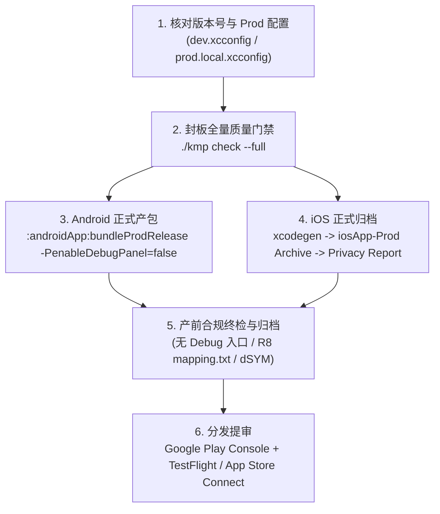

# SOP 0006: 双端正式打包、商店提审与 CI/CD 交付标准指南

> **文档版本**：v1.0  
> **适用平台**：Google Play (Android AAB/APK) & App Store / TestFlight (iOS)  
> **责任角色**：发布管理 / 项目主程 / CI 维护  

---

## 1. 适用场景与触发时机 (When to Use)
- 版本功能封板准备提交 **Google Play Console**（Android App Bundle `.aab`）与 **App Store Connect / TestFlight**（iOS Archive）上线；
- 需要验证正式发布态产物是否彻底剥离调试面板（`:features:debug` & `like.pag`）并开启 R8 压缩混淆；
- 配置或排查 GitHub Actions 自动化构建流程（[`.github/workflows/ci.yml`](../../.github/workflows/ci.yml)）。

---

## 2. 前置准备与权限检查 (Prerequisites)
- [ ] 已按 [SOP 0001](./0001-app-signing-and-certificates.md) 备齐 Android 正式 `.jks` 签名证书与 Apple Distribution 证书 / 描述文件；
- [ ] 已按 [SOP 0002](./0002-code-quality-and-static-analysis.md) 确保工作区全部 L1~L6 检查通过，且 Git 状态无未提交临时改动；
- [ ] 已按 [SOP 0005](./0005-third-party-sdks-and-privacy-compliance.md) 填入真实生产凭证与隐私清单（`PrivacyInfo.xcprivacy`）；
- [ ] 本地已安装 `xcodegen`、`swiftlint`、`shellcheck` 及完整 Xcode 16+ 工具链。

---

## 3. 核心流程图 (Workflow Diagram)



---

## 4. 分步实操指南 (Step-by-Step Instructions)

### 步骤一：同步双端版本号与 Prod 环境配置
双端已收敛为单一真源配置，可直接通过 `./kmp studio prod` 或编辑对应 `.xcconfig` 同步更新：
1. **测试基准版本号**（[`config/dev.xcconfig`](../../config/dev.xcconfig)）与**正式发版版本号**（本地未入库的 `config/prod.local.xcconfig`，未覆写时回退 [`config/prod.xcconfig`](../../config/prod.xcconfig)）：
   ```xcconfig
   APP_ID = com.acme.yourapp
   APP_NAME = YourApp
   VERSION_NAME = 1.0.1
   VERSION_CODE = 2
   ```
   Android Gradle (`applyEnv`) 与 iOS Xcode (`$(MARKETING_VERSION)` / `$(CURRENT_PROJECT_VERSION)`) 会自动双端同步生效，同时核对 `DEVELOPMENT_TEAM` 与正式广告/内购 ID 无误。

### 步骤二：执行封板全量质量门禁 (`--full`)
```bash
./kmp check --full
```
该命令会完整验证：`ShellCheck`、`verifyArchitecture`、`Spotless`、`Detekt`、`allTests`（JVM + iOS Simulator）、`:shared:testAndroidHostTest -PenableDebugPanel=false`、`lintDevDebug`、`lintProdRelease`、临时密钥 `assembleProdRelease` R8 构建、`SwiftLint --strict` 与 `iosApp-Dev` / `iosApp-Prod` 编译测试。

### 步骤三：打包 Android Google Play 正式包 (`.aab`) 与 R8 映射归档
1. 确保本地已通过 `./kmp keystore --type release --write-prod-config` 在 `config/prod.local.xcconfig` 写入真实 `ANDROID_STORE_FILE` / `ANDROID_STORE_PASSWORD` / `ANDROID_KEY_ALIAS` / `ANDROID_KEY_PASSWORD`（或通过 CI Secrets 注入 `PROD_STORE_*` / `PROD_ANDROID_STORE_*`）。
   > [`androidApp/build.gradle.kts`](../../androidApp/build.gradle.kts) 内建强制防误签拦截：若未提供有效 `prod` 签名文件执行 `ProdRelease` 打包任务将直接阻断报错，严禁测试证书流向线上。
2. 构建 Google Play 上架所需的 AAB（显式剥离 Debug 面板与调试资源）：
   ```bash
   ./gradlew :androidApp:bundleProdRelease -PenableDebugPanel=false
   ```
   如需本地直装验证 Release R8 包，改为执行：
   ```bash
   ./gradlew :androidApp:assembleProdRelease -PenableDebugPanel=false
   ```
3. 归档产物与混淆符号表：
   - AAB：`androidApp/build/outputs/bundle/prodRelease/`
   - R8 `mapping.txt`：`androidApp/build/outputs/mapping/prodRelease/mapping.txt`（随版本一起上传至 Google Play Console 与 Firebase Crashlytics，参考 [`androidApp/proguard-rules.pro`](../../androidApp/proguard-rules.pro) 确认 Keep 规则）。

### 步骤四：构建 iOS 正式 Archive 与 Privacy Report 核验
1. 确认 [`iosApp/project.yml`](../../iosApp/project.yml) 对应的 Xcode 工程已包含最新配置与 `PrivacyInfo.xcprivacy`（如增删了源码文件先执行一次生成；`config/prod.local.xcconfig` 与 Firebase `.plist` 变动免重跑 `xcodegen`）：
   ```bash
   cd iosApp && xcodegen generate --spec project.yml
   ```
2. 使用 Xcode 打开 `iosApp/iosApp.xcodeproj`，顶栏选择 **`iosApp-Prod`** Scheme（对应 `Release` 构建配置）：
   - [`iosApp/project.yml`](../../iosApp/project.yml) 已自动在 `Release` 时向 Gradle 传入 `-PenableDebugPanel=false` 并通过 `EXCLUDED_SOURCE_FILE_NAMES: like.pag` 剥离调试资产。
3. 选择目标 `Any iOS Device (arm64)`，点击 **`Product -> Archive`**：
   - 在 Xcode Organizer 右侧点击 **`Generate Privacy Report`**，核对合并所有 SPM 包后的隐私清单无遗漏；
   - 点击 **`Distribute App -> App Store Connect -> Upload`** 上传至 TestFlight 进行真机回归后提交 App Store 审核（同时保留归档内的 `.dSYM` 上传 Crashlytics）。

### 步骤五：GitHub Actions CI/CD 流水线与 Release Secrets 核对
1. **双端拆分布局 CI（[`.github/workflows/ci.yml`](../../.github/workflows/ci.yml)）**：
   - 采用 **Linux + macOS 3-Job 并行拆分架构**，并默认开启 Gradle Configuration Cache（`org.gradle.configuration-cache=true`）：
     1. `fast-static-checks`（`ubuntu-latest`）：执行 `ShellCheck`、`scripts/` Python 单测、Config Studio JS 语法检查、`verifyArchitecture`、`spotlessCheck`、`detekt`；
     2. `android-build-and-test`（`ubuntu-latest`，依赖 `fast-static-checks`）：执行 `testAndroidHostTest`、`:shared:testAndroidHostTest -PenableDebugPanel=false`、`lintDevDebug`/`assembleDevDebug` 以及临时 Keystore 校验 `:androidApp:lintProdRelease :androidApp:assembleProdRelease -PenableDebugPanel=false`；
     3. `ios-build-and-test`（`macos-15`，依赖 `fast-static-checks`）：执行 `iosSimulatorArm64Test`、`swiftlint --strict`、`xcodegen generate`、`xcodebuild` `iosApp-Dev` 单测与 `iosApp-Prod` 构建验证。
   - **基础读取权限**：所有 Job 均声明 `packages: read` 与 `GITHUB_TOKEN: ${{ secrets.GITHUB_TOKEN }}`，用于拉取 GitHub Packages 中的 `e-hai/*` Kit 制品；
   - **CI 正式签名验证**：CI 使用 `scripts/internal/gen_keystore.sh`（经 `./kmp keystore`）生成一次性临时 Keystore 校验 Prod R8 可打包性，不会外泄真实生产证书。
2. **Release CD 发版工作流模板（[`.github/workflows/release.yml`](../../.github/workflows/release.yml)）**：
   - **触发条件**：推送 `v*` 标签自动触发正式构建，或通过 `workflow_dispatch`（默认 `dry_run: true`）进行无 Secrets 演练验证（演练模式下若未配置正式签名，自动回退至临时 Keystore 生成 `.aab` + `mapping.txt` 验证链路）；
   - **产物流水线**：`release-gate` 通过后，`android-release-bundle` 输出 `:androidApp:bundleProdRelease -PenableDebugPanel=false` 的 `.aab` 与 R8 `mapping.txt`（保留 90 天，含可选 Google Play Internal Track 上传注释模板）；`ios-release-verify` 校验 SwiftLint 与 `iosApp-Prod` 构建（含可选签名 Archive / App Store Connect 上传注释模板）。
   - **建议配置的 GitHub Repository / Environment Secrets**：

| Secret 名称 | 用途与解码位置 | 必填说明 |
| :--- | :--- | :--- |
| `PROD_KEYSTORE_BASE64` | Base64 编码的正式 `.jks`，解码至 Runner 临时目录 | `v*` 标签正式发版必填（`dry_run` 可选） |
| `PROD_STORE_PASSWORD` | 正式 Keystore 密码 (`PROD_STORE_PASSWORD`) | 配置 `PROD_KEYSTORE_BASE64` 时必填 |
| `PROD_KEY_ALIAS` | 正式密钥别名 (`PROD_KEY_ALIAS`) | 配置 `PROD_KEYSTORE_BASE64` 时必填 |
| `PROD_KEY_PASSWORD` | 正式密钥密码 (`PROD_KEY_PASSWORD`) | 配置 `PROD_KEYSTORE_BASE64` 时必填 |
| `PROD_LOCAL_XCCONFIG_BASE64` | Base64 编码的 `config/prod.local.xcconfig` | 可选（用于注入正式包名 / Team ID / 商业化 ID） |
| `PROD_GOOGLE_SERVICES_JSON_BASE64` | Base64 编码的 `androidApp/src/prod/google-services.json` | 可选（接入 Firebase Android 时建议配置） |
| `PROD_IOS_GOOGLE_SERVICE_PLIST_BASE64` | Base64 编码的 `iosApp/Config/Firebase/Prod/GoogleService-Info.plist` | 可选（接入 Firebase iOS 时建议配置） |

---

## 5. 验收核对清单 (Verification Checklist)
- [ ] **Debug 完全剥离**：在 Android Release APK 与 iOS `iosApp-Prod` 真机包中，确认不存在 `like.pag` 与调试入口按钮（[`DebugPanelBridge`](../../shared/src/debugDisabled/kotlin/xxx/yyy/zzz/shared/debug/DebugPanelBridge.kt) 编译 `debugDisabled` 分支）；
- [ ] **应用身份与签名**：核对正式包名不含 `.dev` 后缀、桌面名称无 `(Dev)`、Android 使用正式 Release 签名、iOS 使用 `Apple Distribution` 签名；
- [ ] **商店合规零警告**：Google Play Pre-launch report 无崩溃、App Store Connect 上传未触发 `ITMS-91053` Privacy Manifest 拒绝；
- [ ] **符号表可反解**：已同步上传该版本的 R8 `mapping.txt` 与 iOS `.dSYM`。

---

## 6. 常见踩坑与排障 (Troubleshooting / FAQ)

### Q1: 本地打包报错 `【安全隔离拦截】检测到正在打包正式 Release 应用，但未配置有效正式证书 (ANDROID_STORE_FILE)`？
- **原因**：`config/prod.local.xcconfig` 不存在或 `ANDROID_STORE_FILE` 指向的 `.jks` 文件不存在，触发了 [`androidApp/build.gradle.kts`](../../androidApp/build.gradle.kts) 强制签名保护。
- **解决方法**：按 [SOP 0001](./0001-app-signing-and-certificates.md) 生成正式签名库并写入未入库的 `config/prod.local.xcconfig`。

### Q2: 正式包 R8 混淆后运行时出现 `ClassNotFoundException` 或序列化/反序列化崩溃？
- **原因**：新增了带反射、Kotlin Serialization 或第三方原生 SDK 需要的模型类/回调类未保留混淆规则。
- **解决方法**：检查报错类名是否在 [`androidApp/proguard-rules.pro`](../../androidApp/proguard-rules.pro) 补充 `-keep` 规则（如已配置 `@Serializable` 需确保 serialization 插件规则完整），并在本地使用 `assembleProdRelease` 实机冒烟验证。

### Q3: Xcode Archive 报错 `Shared.framework` 架构错误或沙盒权限拒绝？
- **原因**：未关闭 `User Script Sandboxing`，或 `Compile KMP Framework` 未按 `Release` 配置重新导出 `iosArm64` 真机 Framework。
- **解决方法**：确认通过 `cd iosApp && xcodegen generate --spec project.yml` 重新生成工程，保留 `ENABLE_USER_SCRIPT_SANDBOXING: "NO"`，并用 `Clean Build Folder` 后重试 Archive。
