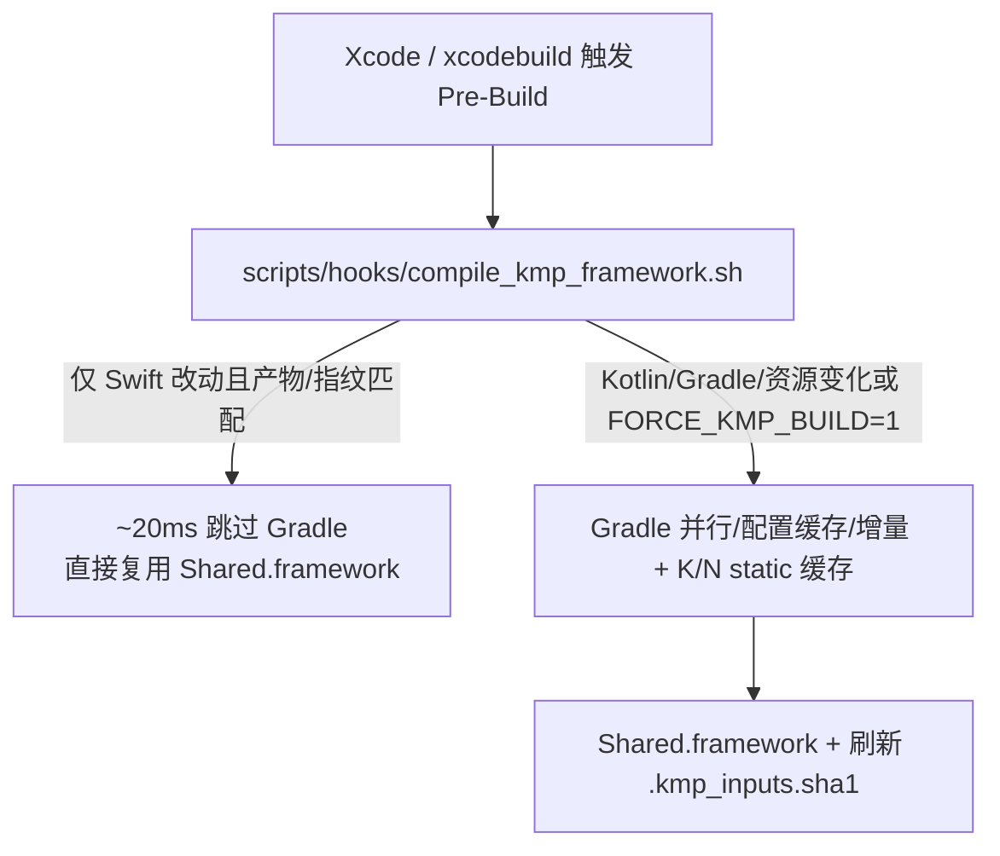

# SOP 0007: 构建加速架构与工具链版本联动升级矩阵

> **文档版本**：v1.0  
> **适用平台**：Android / iOS / KMP 共享层  
> **责任角色**：移动端开发 / 架构维护 / CI 维护  

---

## 1. 适用场景与触发时机 (When to Use)
- 仅修改 iOS 宿主 Swift 代码时希望毫秒级跳过冗余 KMP Gradle 编排与链接；
- 日常排查 Gradle / Kotlin/Native 增量编译、构建缓存与 Debug 符号生成速度；
- 需要升级 Gradle、AGP、Kotlin、Compose Multiplatform、KSP、Detekt、Xcode 等强耦合工具链版本时。

---

## 2. 前置准备与权限检查 (Prerequisites)
- [ ] macOS 15+ / Xcode 16.4+（CI macOS Runner：`macos-15`）/ JDK 17+；
- [ ] 已安装 Python 3（`compile_kmp_framework.sh` 指纹计算）与 `xcodegen`、`shellcheck`、`swiftlint`；
- [ ] 先运行 `./kmp doctor` 确认本机工具链全部为 `[OK]`。

---

## 3. 构建加速与版本联动架构 (Architecture & Matrix)



### 已验证的工具链版本联动锁定矩阵

> ⚠️ KMP + CMP + AGP 9.0 + Xcode 属于强耦合工具链：升级其中任意一项（尤其是 Kotlin / CMP / AGP / Koin Compose），通常需成组联调，严禁单点盲升。

| 组件 / 插件 | 当前锁定版本 | 声明位置 | 强绑定依赖 / 注意事项 |
| :--- | :--- | :--- | :--- |
| **Gradle Wrapper** | `9.5.1` | [`gradle-wrapper.properties`](../../gradle/wrapper/gradle-wrapper.properties) | 配合 `org.gradle.configuration-cache=true` 与 `.parallel=true` |
| **Android Gradle Plugin (AGP)** | `9.3.1` | [`libs.versions.toml`](../../gradle/libs.versions.toml) | 内置 Kotlin + New DSL；KMP 库必须保持 `composeMultiplatform >= 1.9.3` |
| **Kotlin / Kotlin/Native** | `2.3.21` | [`libs.versions.toml`](../../gradle/libs.versions.toml) | 联动 `ksp`（必须同小版本系）与 Compose Compiler 插件 |
| **KSP** | `2.3.8` | [`libs.versions.toml`](../../gradle/libs.versions.toml) | 需与 Kotlin `2.3.x` 匹配（供 Room KMP 编译注解处理器） |
| **Compose Multiplatform (CMP)** | `1.9.3` | [`libs.versions.toml`](../../gradle/libs.versions.toml) | AGP 9 `onVariants` 最低兼容基线 |
| **Koin / Koin Compose** | `4.2.1` | [`libs.versions.toml`](../../gradle/libs.versions.toml) | 传递解析 `org.jetbrains.compose.ui:ui:1.10.2`；`jetbrains-compose-ui-test` 必须同步锁定 `1.10.2` 以防 iOS `IrLinkageError` |
| **Compose UI Test (`ui-test` / `ui-test-manifest` / Robolectric)** | `1.10.2` / `1.9.2` / `4.14.1` | [`libs.versions.toml`](../../gradle/libs.versions.toml) | `jetbrains-compose-ui-test` 与运行时 `ui` 保持同版 |
| **Room KMP / SQLite Bundled** | `2.8.4` / `2.5.0` | [`libs.versions.toml`](../../gradle/libs.versions.toml) | 依赖 KSP `2.3.8` |
| **Detekt / Compose Rules** | `2.0.0-alpha.3` / `0.6.8` | [`libs.versions.toml`](../../gradle/libs.versions.toml) | 升级 Kotlin 大版本时需同步核对 Detekt 对 Kotlin AST 兼容度 |
| **Xcode / iOS CI Runner** | `16.4+` / `macos-15` | [`.github/workflows/ci.yml`](../../.github/workflows/ci.yml) | 编译 `AnalyticsKit-iOS` `1.0.0` 需传 `IPHONEOS_DEPLOYMENT_TARGET=17.0`；Debug 使用 `ONLY_ACTIVE_ARCH=YES` + `dwarf` |

---

## 4. 分步实操指南 (Step-by-Step Instructions)

### 步骤一：了解本工程已启用的构建加速机制
1. **Gradle 并行、缓存与 K/N 静态缓存**：[`gradle.properties`](../../gradle.properties) 统一开启 `org.gradle.parallel=true`、`org.gradle.caching=true`、`org.gradle.configuration-cache=true`、`org.gradle.configuration-cache.parallel=true`、`kotlin.incremental=true` 与 `kotlin.incremental.multiplatform=true`（Kotlin `2.3.20+` 默认启用 Kotlin/Native 静态缓存，已移除废弃的 `kotlin.native.cacheKind` 属性）。
2. **Xcode Swift-Only 改动毫秒级跳过 Gradle**：[`iosApp/project.yml`](../../iosApp/project.yml) 的 `Compile KMP Framework` Phase 调用 [`scripts/hooks/compile_kmp_framework.sh`](../../scripts/hooks/compile_kmp_framework.sh)，按 `(CONFIGURATION, SDK_NAME, ARCHS, enableDebugPanel)` 与源码/资源/构建脚本指纹比对决定是否跳过 `:shared:embedAndSignAppleFrameworkForXcode`。
3. **Debug 单架构与轻量符号**：[`iosApp/project.yml`](../../iosApp/project.yml) 将 `ONLY_ACTIVE_ARCH: YES` 与 `DEBUG_INFORMATION_FORMAT: dwarf` 下沉至 `Debug`，避免日常本地调试生成耗时 `dSYM`；`Release` 保持 `ONLY_ACTIVE_ARCH: NO` 与 `dwarf-with-dsym`。

### 步骤二：强制重编 KMP Framework（如外部环境变量或 Xcode 配置手动变动）
```bash
FORCE_KMP_BUILD=1 ./scripts/hooks/compile_kmp_framework.sh
```

### 步骤三：安全升级工具链版本号的标准流程
1. 修改 [`gradle/libs.versions.toml`](../../gradle/libs.versions.toml) 时，按「Kotlin + KSP + Detekt」与「AGP + CMP + `jetbrains-compose-ui-test` + `koin-compose`」两组联动校验；
2. 清理本地构态并核对 iOS 解析树版本一致（无跨版本 `ui` vs `ui-test` 分裂）：
   ```bash
   ./gradlew :core:ui:dependencyInsight --configuration iosSimulatorArm64TestCompileKlibraries --dependency org.jetbrains.compose.ui:ui
   ```
3. 依次跑通 [`SOP 0002`](./0002-code-quality-and-static-analysis.md) 全量门禁：
   ```bash
   ./kmp check --full
   ```
4. 同步更新本表版本号与 [`SOP 0006`](./0006-release-and-cicd-delivery.md) CI 交付说明。

---

## 5. 验收核对清单 (Verification Checklist)
- [ ] `python3 -B -m unittest scripts/tests/test_compile_kmp_framework.py` 全部通过；
- [ ] `./kmp check --fast` 通过，且 Gradle 构建无未知/废弃属性报错；
- [ ] 本地两次连续运行 `xcodebuild -scheme iosApp-Dev build` 时，第二次日志打印 `[KMP-iOS] Kotlin/Gradle 输入未变化，跳过 Gradle 编排`；
- [ ] 升级任意版本后，`:core:ui:allTests`（含 `iosSimulatorArm64Test`）与 `:androidApp:lintProdRelease` 全部通过。

---

## 6. 常见踩坑与排障 (Troubleshooting / FAQ)

### Q1: iOS Simulator 跑 Compose UI 测试时出现 `IrLinkageError: No class found for symbol ...`？
- **原因**：三方 KMP UI 库（如 `koin-compose`）将 `org.jetbrains.compose.ui:ui` 传递升级到了更新的补丁/次版本，而 `ui-test` 仍留在旧版本导致 KLIB ABI/IR 符号不一致。
- **解决方法**：运行 `./gradlew :core:ui:dependencyInsight --configuration iosSimulatorArm64TestCompileKlibraries --dependency org.jetbrains.compose.ui:ui` 查出实际运行时版本，并在 [`libs.versions.toml`](../../gradle/libs.versions.toml) 将 `jetbrainsComposeUiTest` 对齐至同一版本。

### Q2: 怀疑 `.kmp_inputs.sha1` 缓存命中了旧产物怎么办？
- **原因**：极少数非监听目录内的本地环境变量变更未纳入输入指纹。
- **解决方法**：执行 `FORCE_KMP_BUILD=1` 重新触发 Build，或删除 `shared/build/xcode-frameworks` 目录后重试。
