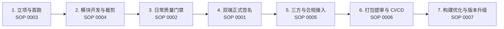

# 标准作业程序 (SOP) 体系总览与索引

本目录汇总 KMP + CMP + Android / iOS 双端架构全生命周期的标准作业程序（Standard Operating Procedures）。与记录“为什么这么设计（Why）”的 [ADR 目录](../adr/) 互补，本目录聚焦**“具体怎么操作（How）”**与**验收排查清单**。

---

## 全生命周期 SOP 索引表

| 编号 | 文档标题与入口 | 适用阶段 | 核心脚本 / 配置 |
| :--- | :--- | :--- | :--- |
| **SOP 0000** | [标准 SOP 文档模板](./0000-sop-template.md) | 文档协作规范 | — |
| **SOP 0001** | [Android 与 iOS 双端应用签名与证书管理指南](./0001-app-signing-and-certificates.md) | 证书与密钥筹备 | [`kmp`](../../kmp) (`keystore`)、[`config/prod.xcconfig`](../../config/prod.xcconfig) |
| **SOP 0002** | [全链路代码质量检测与静态分析标准作业程序](./0002-code-quality-and-static-analysis.md) | 编码 / 提交 / 静态门禁 | [`kmp`](../../kmp) (`check`)、[`.githooks/pre-commit`](../../.githooks/pre-commit) |
| **SOP 0003** | [新项目立项初始化与双端开发环境搭建指南](./0003-project-init-and-dev-environment.md) | 新项目立项与首跑 | [`kmp`](../../kmp) (`studio` / `init`)、[`tools/config-studio/index.html`](../../tools/config-studio/index.html) |
| **SOP 0004** | [业务特性模块开发、Kit 热插拔与自定义新 Kit 接入指南](./0004-feature-and-kit-lifecycle.md) | 日常开发与模块演进 | [`kmp`](../../kmp) (`feature` / `kit`)、[`scripts/internal/manage_kit.sh`](../../scripts/internal/manage_kit.sh) |
| **SOP 0005** | [商业化三方 SDK 配置与隐私合规分阶段激活指南](./0005-third-party-sdks-and-privacy-compliance.md) | 商业化接入与合规 | [`config/dev.xcconfig`](../../config/dev.xcconfig)、[`iosApp/Sources/PrivacyInfo.xcprivacy`](../../iosApp/Sources/PrivacyInfo.xcprivacy)、[`AppBootstrap.kt`](../../shared/src/commonMain/kotlin/xxx/yyy/zzz/shared/di/AppBootstrap.kt) |
| **SOP 0006** | [双端正式打包、商店提审与 CI/CD 交付标准指南](./0006-release-and-cicd-delivery.md) | 封板打包与商店上架 | [`androidApp/proguard-rules.pro`](../../androidApp/proguard-rules.pro)、[`iosApp/project.yml`](../../iosApp/project.yml)、[`.github/workflows/ci.yml`](../../.github/workflows/ci.yml) |
| **SOP 0007** | [构建加速架构与工具链版本联动升级矩阵](./0007-build-performance-and-version-upgrade-matrix.md) | 构建提速与版本升级 | [`gradle.properties`](../../gradle.properties)、[`gradle/libs.versions.toml`](../../gradle/libs.versions.toml)、[`compile_kmp_framework.sh`](../../scripts/hooks/compile_kmp_framework.sh) |

---

## 推荐阅读与执行路径

---

## 新增与维护 SOP 规范
1. **统一结构**：新建 SOP 须复制 [`0000-sop-template.md`](./0000-sop-template.md) 保持 6 段标准结构（适用场景、前置检查、流程图、分步指南、验收清单、排障 FAQ）；
2. **可移植相对链接**：仓库内全部 `.md` 文档统一使用相对路径互链（如 `./0001-app-signing-and-certificates.md` 或 `../../kmp`），禁止写入本机绝对路径链接；
3. **事实同步**：修改脚本参数、Gradle 任务或配置文件路径后，需同步更新对应 SOP 并运行链接完整性核对与 `./kmp check --fast`。
